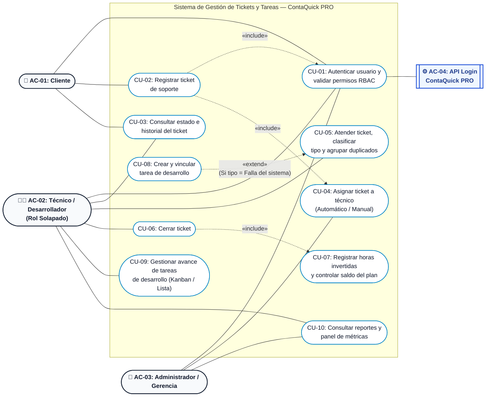
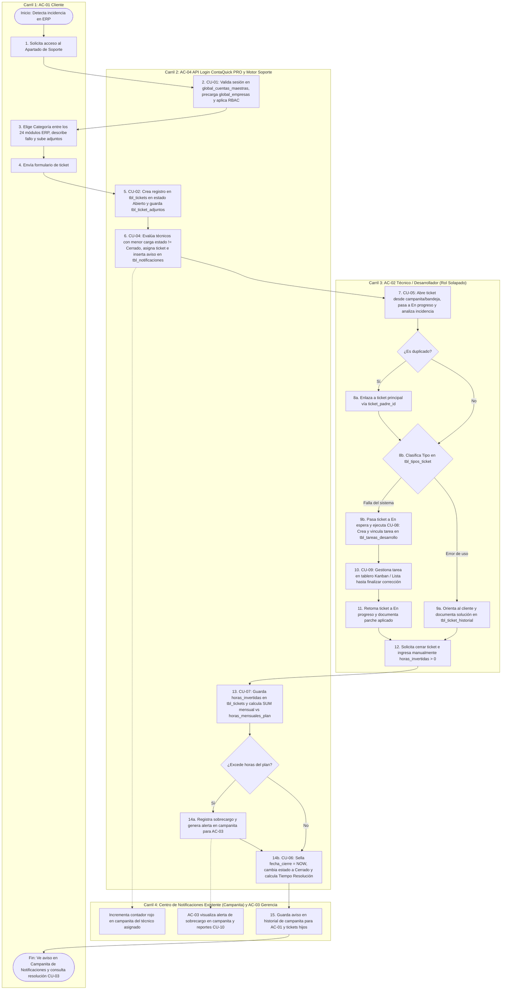
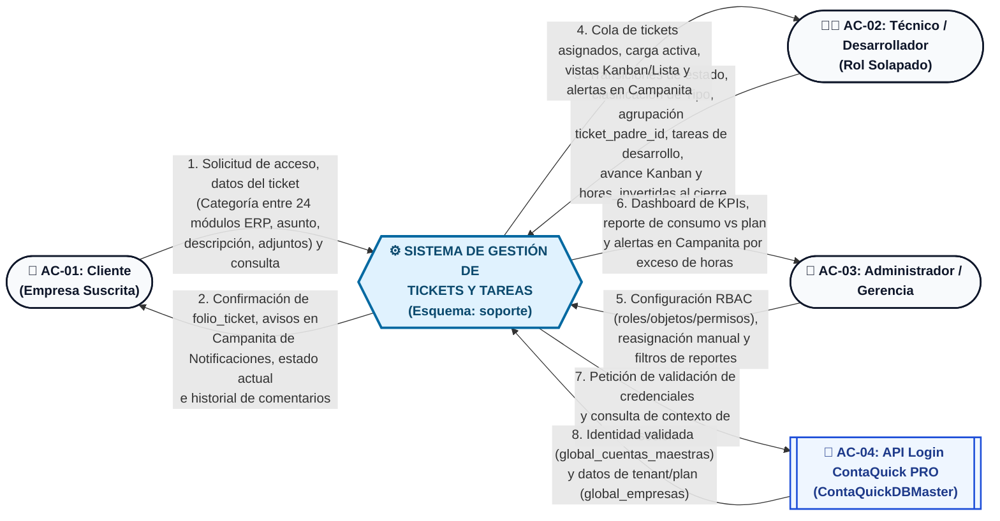
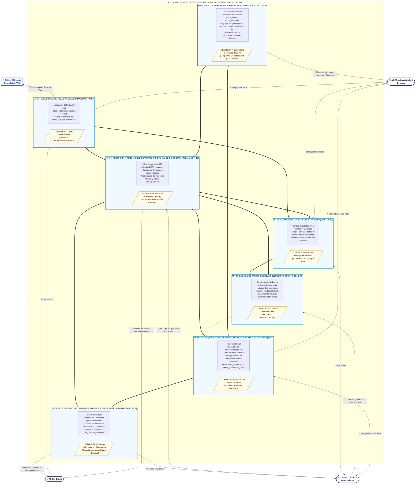
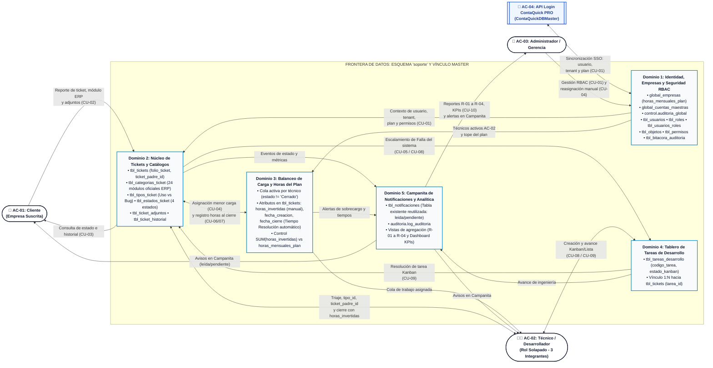
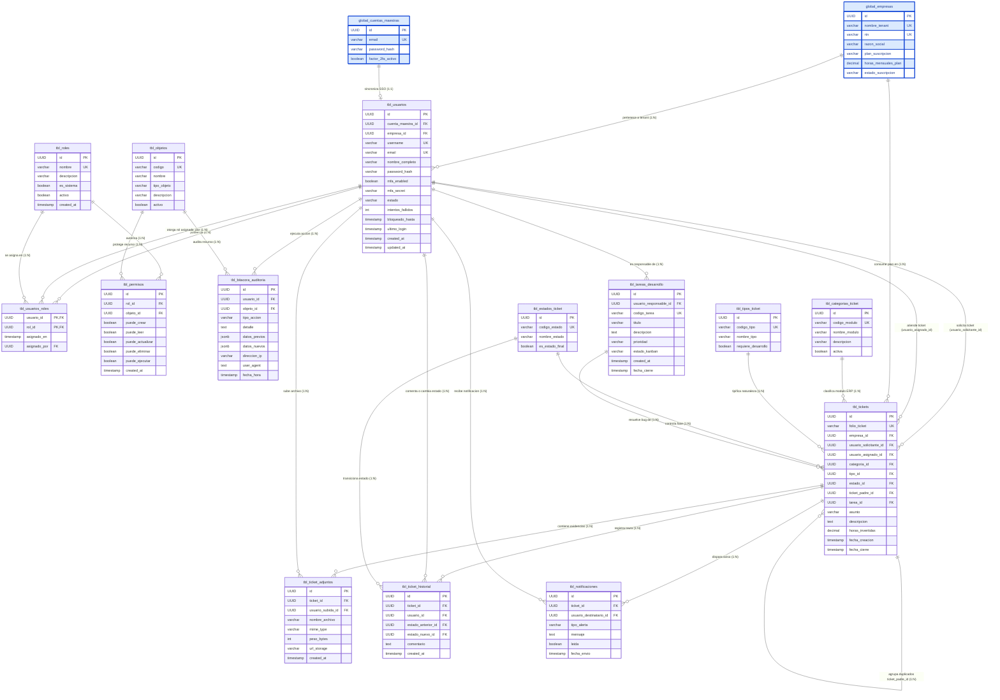
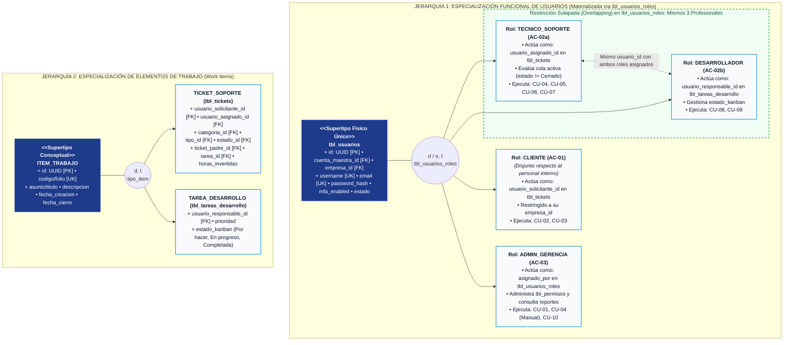
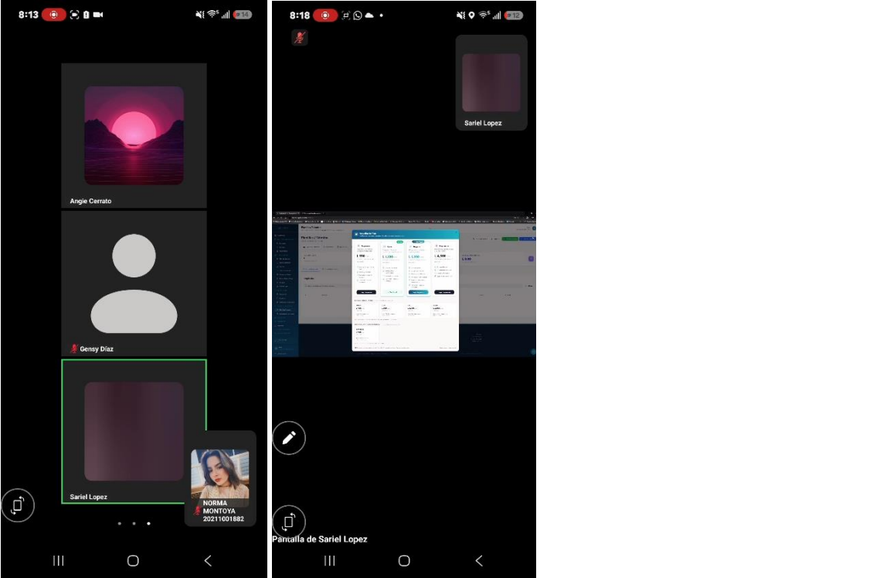

<!-- TABLA INVISIBLE PARA LA CABECERA -->
<table class="cover-header" border="0" width="100%">
  <tr>
    <td align="left" width="15%">
      
    </td>
    <td align="center" width="70%">
      <strong>UNIVERSIDAD NACIONAL AUTÓNOMA DE HONDURAS</strong> 
      <strong>CARRERA DE INFORMÁTICA ADMINISTRATIVA</strong> 
      <strong>FACULTAD DE CIENCIAS ECONÓMICAS, ADMINISTRATIVAS Y CONTABLES</strong>
    </td>
    <td align="right" width="15%">
      
    </td>
  </tr>
</table>
<!-- FIN DE LA CABECERA -->

  

**CLASE:** 
**DIA-158 ARQUITECTURA DE SOFTWARE II**

  

Título del Documento: 
**Informe de Avance Unidad II - Modelado Lógico y Requerimientos.**

  

Nombre del Proyecto: 
**Sistema de Gestión de Tickets y Tareas**

  

Empresa: 
**ContaQuick PRO**

  

Integrantes del equipo:

<!-- TABLA DE INTEGRANTES -->
<table class="integrantes">
  <thead>
    <tr style="background-color: #4a90e2; color: white;">
      <th>No.</th>
      <th>Nombre del Estudiante</th>
      <th>Cuenta</th>
    </tr>
  </thead>
  <tbody>
    <tr>
      <td>1</td>
      <td>Néstor Julián Déctor Rojas</td>
      <td>20232000391</td>
    </tr>
    <tr>
      <td>2</td>
      <td>Norma Xiomara Montoya Rivera</td>
      <td>20211001882</td>
    </tr>
    <tr>
      <td>3</td>
      <td>Gensy Andony Díaz Aguilar</td>
      <td>20221000528</td>
    </tr>
    <tr>
      <td>4</td>
      <td>Anthony Moises Barahona Rodriguez</td>
      <td>20231001719</td>
    </tr>
    <tr>
      <td>5</td>
      <td>Angie Yisel Cerrato Flores</td>
      <td>20231002845</td>
    </tr>
  </tbody>
</table>

 

Fecha de entrega: 15/11/2026

# Introducción
El presente Informe de Avance de la Unidad II consolida el modelado lógico, funcional y de datos del Sistema de Gestión de Tickets y Tareas para la empresa hondureña ContaQuick PRO, tomando como línea base el diagnóstico operativo, el alcance del Producto Mínimo Viable (MVP) y las diez necesidades de negocio (N-01 a N-10) levantadas durante la Unidad I. Mientras que la primera fase del proyecto permitió evidenciar la problemática derivada de atender las solicitudes de soporte de forma dispersa por correo electrónico y sin un control formal del consumo de horas por cliente, esta segunda etapa transforma dichos requerimientos en una arquitectura lógica verificable y lista para su construcción.
 
El documento se estructura en cuatro secciones técnicas interconectadas. En la primera sección se desarrolla el Modelado de Casos de Uso, identificando los cuatro actores oficiales del negocio (AC-01 a AC-04), documentando las diez funcionalidades centrales (CU-01 a CU-10), su jerarquización crítica y el flujo extremo a extremo mediante un diagrama UML BPM por carriles. En la segunda sección se analizan las Dependencias Funcionales, estableciendo la precedencia constructiva de los módulos a través del Diagrama de Contexto y del Diagrama de Macrofunciones con sus respectivas salidas operativas. En la tercera sección se presentan los Modelos de Datos Iniciales, abarcando el modelo de contexto de datos, el modelo basado en claves, las jerarquías de especialización —incluyendo el rol solapado de los tres desarrolladores de la empresa—, los formatos de reportes gerenciales y los formatos de salida requeridos por la gerencia. Finalmente, en la cuarta sección se ejecuta el Análisis y Normalización de Datos desde la Forma No Normalizada (0FN) hasta la Cuarta Forma Normal (4FN), culminando con el Diagrama Entidad-Relación (DER) definitivo sobre PostgreSQL 14+, su Diccionario de Datos físico acoplado a ContaQuickDBMaster y la matriz de trazabilidad hacia los requerimientos del sistema.

# 1. Modelado de Casos de Uso
El modelado de casos de uso permite identificar y describir las funcionalidades que ofrecerá el Sistema de Gestión de Tickets y Tareas, así como las interacciones entre los usuarios y el sistema. 
En esta sección se identifican los actores que interactúan con el Sistema de Gestión de Tickets y Tareas, así como las responsabilidades que desempeñan dentro del sistema.
## 1.1 Catálogo de Actores

| ID | Actor | Tipo | Rol y Responsabilidad en el Negocio |
| :--- | :--- | :--- | :--- |
| **AC-01** | **Cliente** | Primario (Humano) | Usuario de una empresa suscrita a ContaQuick PRO que inicia sesión, registra tickets desde el apartado de soporte, revisa avisos en la campanita de notificaciones y consulta el estado e historial de sus solicitudes. |
| **AC-02** | **Técnico / Desarrollador** | Primario (Humano - Solapado) | Miembro del equipo técnico (los 3 desarrolladores actuales) con rol dual: atiende tickets, clasifica incidencias, agrupa duplicados, registra horas efectivas manualmente al cierre y ejecuta tareas en el tablero Kanban. |
| **AC-03** | **Administrador / Gerencia** | Primario (Humano) | Configura roles/permisos RBAC, reasigna carga manualmente, supervisa el consumo de horas frente al plan mensual de cada empresa y consulta métricas operativas. |
| **AC-04** | **API Login ContaQuick PRO** | Secundario (Sistema Externo) | Servicio de autenticación central (`ContaQuickDBMaster`) que valida credenciales y retorna vía API ligera los datos de usuario, cuenta maestra, empresa (`tenant`) y plan activo. |

## 1.2 Catálogo de Casos de Uso
Se identifican las principales funcionalidades que ofrece el sistema a cada uno de sus actores, considerando los requerimientos funcionales establecidos.

| ID | Nombre del Caso de Uso | Actor(es) | Relación / Dependencia | Código (Tomado de libro de necesidades)|
|---|---|---|---|---|
| CU-01 | Autenticar usuario y validar permisos RBAC | AC-01, AC-02, AC-03, AC-04 | Base transversal (incluye gestión de roles por AC-03) | N-07 (Gestión de usuarios y roles)|
| CU-02 | Registrar ticket de soporte | AC-01 | «include» CU-01, CU-04 | N-01 (Registro centralizado), N-06 (Clasificación), N-08 (UI), N-10 (Canal de entrada)|
| CU-03 | Consultar estado e historial del ticket | AC-01, AC-02 | Precedencia: CU-01, CU-02 | N-01 (Registro centralizado), N-09 (Notificaciones e historial)|
| CU-04 | Asignar ticket a técnico (Automático / Manual) | Sistema / AC-03 | «include» en CU-02 (Reasignación manual como flujo alterno) | N-02 (Asignación automática según carga), N-09 (Notificaciones)|
| CU-05 | Atender ticket, clasificar tipo y agrupar duplicados | AC-02 | Precedencia: CU-04. Incluye vínculo ticket_padre_id | N-01 (Registro centralizado), N-02 (Asignación), N-06 (Clasificación), N-09 (Historial)|
| CU-06 | Cerrar ticket | AC-02 | «include» CU-07. Precedencia: CU-05 | N-01 (Registro centralizado), N-03 (Registro de horas), N-09 (Notificaciones)|
| CU-07 | Registrar horas invertidas y controlar saldo del plan | AC-02 / Sistema | «include» en CU-06 (Dispara alerta si excede cupo mensual) | N-03 (Registro de horas invertidas por ticket), N-09 (Notificaciones)|
| CU-08 | Crear y vincular tarea de desarrollo | AC-02 | «extend» de CU-05 (Solo cuando tipo = Falla del sistema) | N-05 (Tablero de tareas de desarrollo), N-06 (Clasificación por tipo)|
| CU-09 | Gestionar avance de tareas de desarrollo (Kanban / Lista) | AC-02 | Precedencia: CU-08 | N-05 (Tablero de tareas de desarrollo), N-08 (Interfaz intuitiva y responsiva)|
| CU-10 | Consultar reportes y panel de métricas | AC-03, AC-02 | Precedencia: CU-06, CU-07 | N-04 (Reportes y panel de métricas)|

## 1.3 Diagrama General de Casos de Uso
En esta sección se presenta el diagrama general de casos de uso, donde se representan gráficamente los actores, las funcionalidades del sistema y las relaciones existentes entre ellas.

## 1.4 Narración Documentación de Casos de Uso
### 1.4.1. CU-01: Autenticar usuario y validar permisos RBAC

| Elemento | Descripción|
|---|---|
| **ID y nombre** | CU-01 / Autenticar usuario y validar permisos RBAC|
| **Actor principal** | AC-01 Cliente, AC-02 Técnico / Desarrollador, AC-03 Administrador / Gerencia (Actor secundario: AC-04 API Login ContaQuick PRO)|
| **Objetivo** | Validar las credenciales de acceso mediante la API central de ContaQuick PRO, sincronizar los datos del usuario, empresa (tenant) y plan de suscripción, y aplicar el control de acceso dinámico basado en roles (RBAC) sobre las pantallas del sistema.|
| **Precondiciones** | El usuario cuenta con un registro activo en `global_cuentas_maestras` y su empresa posee una suscripción registrada en `global_empresas`.|
| **Disparador** | El usuario ingresa al apartado de soporte o al panel administrativo del Sistema de Gestión de Tickets y Tareas.|
| **Flujo normal** | 1. El usuario solicita acceso al módulo de soporte desde su sesión activa o pantalla de ingreso. 2. El sistema envía la solicitud de validación de credenciales al servicio externo AC-04 API Login ContaQuick PRO. 3. AC-04 valida la identidad en `global_cuentas_maestras` y retorna el paquete con los datos del usuario, empresa (`global_empresas`) y cupo `horas_mensuales_plan`. 4. El sistema verifica el perfil del usuario en `tbl_usuarios`, su rol en `tbl_roles` y consulta la matriz de permisos en `tbl_permisos` asociada a las pantallas (`tbl_objetos`). 5. El sistema registra el evento de acceso en la bitácora `control.auditoria_global` y despliega únicamente las vistas y acciones permitidas para su rol.|
| **Flujos alternos / excepciones** | **A1)** Si las credenciales son inválidas o la sesión expiró, el sistema rechaza el acceso, registra el fallo en `control.auditoria_global` y solicita iniciar sesión nuevamente. **A2)** Si AC-03 Administrador / Gerencia crea o modifica la asignación de roles o permisos sobre pantallas (`tbl_objetos`), el sistema actualiza `tbl_permisos` y deja rastro en `auditoria.log_auditoria`.|
| **Postcondiciones** | El usuario tiene una sesión autenticada con su contexto de empresa precargado y sus permisos RBAC aplicados en interfaz y backend.|
| **Documento del negocio** | Sesión autenticada, matriz de permisos en `tbl_permisos` y registro en `control.auditoria_global`.|
| **Reglas de negocio** | La segmentación de vistas se da estrictamente en base al rol (CLIENTE, TECNICO_DEV, ADMIN_GERENCIA) mediante las 4 tablas dinámicas de seguridad (`tbl_roles`, `tbl_usuarios`, `tbl_objetos`, `tbl_permisos`). El sistema no accede a la base de datos contable del cliente, solo consume la API de identidad.|
| **Necesidad asociada** | N-07: Gestión de usuarios y roles|

### 1.4.2. CU-02: Registrar ticket de soporte

| Elemento | Descripción|
|---|---|
| **ID y nombre** | CU-02 / Registrar ticket de soporte|
| **Actor principal** | AC-01 Cliente |
| **Objetivo** | Reportar un problema de ContaQuick PRO desde el apartado de soporte web, eligiendo el módulo afectado, describiendo el problema y adjuntando evidencias.|
| **Precondiciones** | El cliente inició sesión y fue validado mediante CU-01, teniendo precargados los datos de su usuario y empresa.|
| **Disparador** | El cliente detecta un problema en la plataforma contable y abre el apartado de soporte.|
| **Flujo normal** | 1. El cliente abre el apartado de soporte integrado en la plataforma. 2. El sistema precarga automáticamente los datos de `empresa_id` y `cliente_id` desde la sesión activa (CU-01). 3. El cliente selecciona la categoría (módulo afectado de `tbl_categorias_ticket`) de la lista oficial de ContaQuick PRO. 4. El cliente escribe el asunto y la `descripcion` detallada del problema. 5. El cliente adjunta capturas de pantalla u otras evidencias. 6. El cliente envía el formulario. 7. El sistema crea el registro en `tbl_tickets` con un `folio_ticket` único, estado inicial **Abierto** (`tbl_estados_ticket`) y `fecha_creacion = NOW()`, almacenando los archivos en `tbl_ticket_adjuntos`. 8. El sistema ejecuta la asignación automática del ticket a un técnico (CU-04). 9. El sistema registra la creación en `tbl_ticket_historial`, genera la alerta en `tbl_notificaciones` (visible en la campanita del centro de notificaciones existente) y muestra al cliente la confirmación con el número de folio.|
| **Flujos alternos / excepciones** | **A1)** Si falta la categoría (módulo), el asunto o la descripción, el sistema no envía el formulario y solicita completar los campos obligatorios. **A2)** Si un archivo adjunto tiene un formato (`mime_type`) o tamaño (`peso_bytes`) no permitido, el sistema lo rechaza e indica el motivo antes de guardar en `tbl_ticket_adjuntos`. **A3)** Si la sesión expiró, el sistema invoca CU-01 para autenticar de nuevo.|
| **Postcondiciones** | Existe un ticket registrado en `tbl_tickets` en estado **Abierto**, con sus adjuntos en `tbl_ticket_adjuntos`, asignado a un técnico, con su historial inicial en `tbl_ticket_historial` y las notificaciones enviadas.|
| **Documento del negocio** | Registro de ticket en `tbl_tickets` y archivos en `tbl_ticket_adjuntos`.|
| **Reglas de negocio** | La categoría (módulo ERP) y la descripción son obligatorias. Las categorías provienen de los 24 módulos oficiales de ContaQuick PRO (`tbl_categorias_ticket`). El cliente solo selecciona el módulo; el tipo de ticket (`tipo_id`) nace nulo (NULL) y lo define el técnico posteriormente. El estado inicial siempre es **Abierto**.|
| **Necesidad asociada** | N-01 (Registro centralizado), N-06 (Clasificación), N-08 (Interfaz intuitiva y responsiva), N-10 (Canal de entrada)|

### 1.4.3. CU-03: Consultar estado e historial del ticket

| Elemento | Descripción|
|---|---|
| **ID y nombre** | CU-03 / Consultar estado e historial del ticket|
| **Actor principal** | AC-01 Cliente, AC-02 Técnico / Desarrollador|
| **Objetivo** | Consultar el progreso actual de las solicitudes de soporte y el historial detallado de cambios y comentarios.|
| **Precondiciones** | El usuario inició sesión (CU-01) y existen tickets registrados asociados a su empresa o bandeja de trabajo.|
| **Disparador** | El cliente o el técnico requiere verificar el avance y seguimiento de un ticket.|
| **Flujo normal** | 1. El usuario accede a la bandeja de tickets dentro del apartado de soporte o panel técnico. 2. El sistema consulta `tbl_tickets` filtrando según el rol del usuario (`tbl_permisos`) y muestra el listado con `folio_ticket`, asunto, categoría (`tbl_categorias_ticket`), estado (`tbl_estados_ticket`) y `fecha_creacion`. 3. El usuario selecciona un ticket específico. 4. El sistema despliega el detalle completo: estado actual, técnico asignado, archivos en `tbl_ticket_adjuntos` y la línea de tiempo de `tbl_ticket_historial` con fechas, transiciones de estado y comentarios técnicos. 5. El usuario puede consultar sus avisos relacionados en el centro de notificaciones (`tbl_notificaciones`).|
| **Flujos alternos / excepciones** | **A1)** Si el usuario no tiene tickets registrados o asignados que coincidan con los filtros de búsqueda (por empresa o estado), el sistema muestra un mensaje informativo indicando que no existen registros.|
| **Postcondiciones** | No se modifica ningún dato en la base de datos (operación de lectura).|
| **Documento del negocio** | Vista de detalle de `tbl_tickets` y bitácora cronológica de `tbl_ticket_historial`.|
| **Reglas de negocio** | Los estados oficiales posibles son 4: **Abierto**, **En progreso**, **En espera** y **Cerrado** (`tbl_estados_ticket`). Un usuario con rol CLIENTE únicamente puede visualizar los tickets pertenecientes a su propia `empresa_id`.|
| **Necesidad asociada** | N-01 (Registro centralizado), N-09 (Notificaciones e historial de cambios)|

### 1.4.4. CU-04: Asignar ticket a técnico (Automático / Manual)

| Elemento | Descripción|
|---|---|
| **ID y nombre** | CU-04 / Asignar ticket a técnico (Automático / Manual)|
| **Actor principal** | Sistema (incluido en CU-02) / AC-03 Administrador / Gerencia (en reasignación manual)|
| **Objetivo** | Asignar automáticamente cada ticket nuevo al miembro del equipo técnico con menor carga laboral activa, permitiendo la reasignación manual cuando se requiera.|
| **Precondiciones** | Se acaba de crear un ticket (CU-02) o se requiere reasignar uno activo, y existen usuarios con rol TECNICO_DEV activos en `tbl_usuarios`.|
| **Disparador** | Creación de un nuevo ticket en `tbl_tickets` (CU-02) o solicitud de cambio de responsable por AC-03.|
| **Flujo normal** | 1. El sistema consulta en `tbl_usuarios` todos los integrantes activos con rol TECNICO_DEV. 2. El sistema calcula en tiempo real la carga activa de cada técnico contando sus registros en `tbl_tickets` cuyo estado en `tbl_estados_ticket` sea distinto de **Cerrado** (`estado != 'Cerrado'`). 3. El sistema selecciona al técnico con la menor cantidad de tickets activos. 4. El sistema actualiza el atributo `tecnico_id` en `tbl_tickets` y registra la asignación en `tbl_ticket_historial`. 5. El sistema inserta el aviso para el técnico asignado en `tbl_notificaciones` para mostrarla en la campanita de notificaciones.|
| **Flujos alternos / excepciones** | **A1) Reasignación manual:** AC-03 Administrador / Gerencia (o un técnico autorizado) selecciona manualmente un nuevo `tecnico_id` para un ticket abierto o en progreso; el sistema actualiza `tbl_tickets`, guarda el cambio de responsable en `tbl_ticket_historial` y notifica al nuevo encargado en `tbl_notificaciones`.|
| **Postcondiciones** | El registro en `tbl_tickets` posee un `tecnico_id` válido asignado, el movimiento consta en `tbl_ticket_historial` y el técnico fue notificado.|
| **Documento del negocio** | Asignación en `tbl_tickets`, traza en `tbl_ticket_historial` y alerta en `tbl_notificaciones`.|
| **Reglas de negocio** | La carga laboral se mide estrictamente por la cantidad de tickets asignados que no están en estado **Cerrado**. El algoritmo es dinámico y funciona con cualquier cantidad de técnicos activos en `tbl_usuarios`, no solo con los tres desarrolladores actuales.|
| **Necesidad asociada** | N-02 (Asignación automática según carga del técnico), N-09 (Notificaciones e historial)|

### 1.4.5. CU-05: Atender ticket, clasificar tipo y agrupar duplicados

| Elemento | Descripción|
|---|---|
| **ID y nombre** | CU-05 / Atender ticket, clasificar tipo y agrupar duplicados|
| **Actor principal** | AC-02 Técnico / Desarrollador |
| **Objetivo** | Atender el ticket asignado, gestionar sus cambios de estado (En progreso / En espera), tipificar si corresponde a un error de uso o a una falla del sistema y agrupar tickets duplicados bajo un ticket padre.|
| **Precondiciones** | El ticket se encuentra registrado en `tbl_tickets` y asignado al técnico (CU-04).|
| **Disparador** | El técnico recibe la notificación de asignación y abre el ticket en su panel de gestión.|
| **Flujo normal** | 1. El técnico abre el ticket y revisa el asunto, la `descripcion`, el módulo (`categoria_id`) y las evidencias en `tbl_ticket_adjuntos`. 2. El técnico cambia el estado del ticket a **En progreso** (`tbl_estados_ticket`). 3. El técnico analiza el incidente y selecciona obligatoriamente el tipo en `tbl_tipos_ticket` (`tipo_id`): **Error de uso** o **Falla del sistema**. 4. Si se clasifica como **Error de uso**, el técnico redacta la orientación o respuesta para el cliente en `tbl_ticket_historial` y continúa hacia el cierre (CU-06). 5. Si se clasifica como **Falla del sistema** (`requiere_desarrollo = TRUE`), el técnico procede a crear o vincular una tarea de desarrollo (CU-08) y puede colocar el ticket en estado **En espera** mientras se corrige el defecto. 6. El sistema registra cada transición (`estado_anterior_id` → `estado_nuevo_id`) y comentario en `tbl_ticket_historial` y envía el aviso al cliente en el historial de la campanita (`tbl_notificaciones`).|
| **Flujos alternos / excepciones** | **A1) Agrupación de tickets duplicados (Padre-Hijo):** Si el técnico identifica que dos o más tickets reportan exactamente la misma falla raíz, enlaza los tickets secundarios al caso principal asignándoles la FK recursiva `ticket_padre_id` en `tbl_tickets` y concentrándolos bajo el mismo responsable para su resolución y notificación conjunta. **A2) Paso a estado En espera por falta de datos:** Si el técnico requiere información adicional del cliente, cambia el estado a **En espera** y solicita el detalle en `tbl_ticket_historial`.|
| **Postcondiciones** | El ticket tiene su estado actualizado (**En progreso** o **En espera**), su `tipo_id` definido en `tbl_tickets`, posibles duplicados enlazados vía `ticket_padre_id`, y los cambios registrados en `tbl_ticket_historial` y `tbl_notificaciones`.|
| **Documento del negocio** | Actualización de `tbl_tickets` y registro de trazabilidad en `tbl_ticket_historial`.|
| **Reglas de negocio** | Existen 4 estados oficiales: **Abierto**, **En progreso**, **En espera** y **Cerrado**. La Categoría (`tbl_categorias_ticket`) indica el módulo contable y la elige el cliente; el Tipo (`tbl_tipos_ticket`) indica la naturaleza del fallo (**Error de uso** vs. **Falla del sistema**) y lo define exclusivamente el técnico. Ningún ticket puede cerrarse sin tener su `tipo_id` asignado.|
| **Necesidad asociada** | N-01 (Registro centralizado), N-02 (Asignación), N-06 (Clasificación de tickets por tipo), N-09 (Notificaciones e historial)|

### 1.4.6. CU-06: Cerrar ticket

| Elemento | Descripción|
|---|---|
| **ID y nombre** | CU-06 / Cerrar ticket|
| **Actor principal** | AC-02 Técnico / Desarrollador |
| **Objetivo** | Formalizar el cierre del ticket una vez resuelto el incidente, exigiendo el registro de las horas invertidas, sellando la fecha de cierre y notificando la solución al cliente.|
| **Precondiciones** | El ticket está asignado al técnico, en estado **En progreso** o **En espera**, y cuenta con su `tipo_id` clasificado (CU-05).|
| **Disparador** | El técnico ha solucionado la consulta del cliente o se ha completado la tarea de desarrollo vinculada.|
| **Flujo normal** | 1. El técnico abre el ticket y selecciona la opción de cambiar estado a **Cerrado**. 2. El sistema invoca de forma obligatoria el registro de horas invertidas y control de saldo del plan (CU-07). 3. Una vez validadas las horas en CU-07, el sistema actualiza `estado_id` a **Cerrado** (`es_estado_final = TRUE`) y sella `fecha_cierre = NOW()` directamente en `tbl_tickets`. 4. El sistema inserta el registro de cierre y el resumen de resolución en `tbl_ticket_historial` y en la bitácora operativa `auditoria.log_auditoria`. 5. El sistema genera el aviso de resolución en `tbl_notificaciones` en el centro de notificaciones existente (campanita) para el cliente solicitante (y a todos los clientes de tickets hijos vinculados por `ticket_padre_id`).|
| **Flujos alternos / excepciones** | **A1)** Si el ticket no tiene `tipo_id` definido o si las horas ingresadas en CU-07 son inválidas (vacías, cero o negativas), el sistema bloquea la transición a **Cerrado** e indica el dato faltante.|
| **Postcondiciones** | El ticket queda en estado final **Cerrado** con `fecha_cierre` y `horas_invertidas` selladas en `tbl_tickets`, historial actualizado y cliente notificado.|
| **Documento del negocio** | Ticket cerrado en `tbl_tickets`, traza en `tbl_ticket_historial` y notificación en `tbl_notificaciones`.|
| **Reglas de negocio** | **Cerrado** es un estado final sin transiciones de salida. Está prohibido cerrar un ticket sin haber registrado `horas_invertidas > 0` y sin haber definido `tipo_id`. Si se cierra un ticket padre con tickets duplicados asociados (`ticket_padre_id`), el cierre permite notificar simultáneamente a todos los clientes afectados.|
| **Necesidad asociada** | N-01 (Registro centralizado), N-03 (Registro de horas invertidas), N-09 (Notificaciones e historial)|

### 1.4.7. CU-07: Registrar horas invertidas y controlar saldo del plan

| Elemento | Descripción|
|---|---|
| **ID y nombre** | CU-07 / Registrar horas invertidas y controlar saldo del plan|
| **Actor principal** | AC-02 Técnico / Desarrollador / Sistema (incluido en CU-06)|
| **Objetivo** | Registrar directamente en el ticket las horas efectivas dedicadas por el técnico, calcular el tiempo total de resolución y verificar el consumo mensual acumulado de la empresa frente al límite de su plan contratado.|
| **Precondiciones** | El técnico ha iniciado la acción de cierre del ticket (CU-06).|
| **Disparador** | Confirmación de cierre de un ticket en CU-06.|
| **Flujo normal** | 1. El sistema solicita al técnico ingresar el tiempo efectivo invertido en la atención del caso. 2. El técnico digita manualmente el valor en el campo `horas_invertidas` DECIMAL(6,2). 3. El sistema valida que el valor sea numérico y mayor que cero (> 0). 4. El sistema guarda el atributo `horas_invertidas` directamente en el registro de `tbl_tickets` (sin utilizar tablas externas de registro de horas ni cronómetros). 5. El sistema calcula al vuelo el **Tiempo de Resolución** restando `fecha_cierre - fecha_creacion`. 6. El sistema ejecuta la sumatoria `SUM(horas_invertidas)` de todos los tickets cerrados en el mes en curso para esa `empresa_id` y la compara contra el atributo `horas_mensuales_plan` de `global_empresas` (ej. 15.00 horas en el Plan Pyme).|
| **Flujos alternos / excepciones** | **A1) Valor inválido:** Si `horas_invertidas` está vacío, es cero o es negativo, el sistema rechaza el dato e impide completar CU-06. **A2) Saldo del plan agotado o excedido:** Si la sumatoria mensual `SUM(horas_invertidas)` iguala o supera `horas_mensuales_plan` en `global_empresas`, el sistema muestra una alerta en pantalla y despacha una notificación prioritaria en la campanita (`tbl_notificaciones`) a AC-03 Administrador / Gerencia para gestionar el cobro de horas adicionales.|
| **Postcondiciones** | El atributo `horas_invertidas` queda almacenado en `tbl_tickets`, el consumo mensual de la empresa queda actualizado y, en caso de exceso, la gerencia ha sido alertada.|
| **Documento del negocio** | Atributo `horas_invertidas` y marcas de tiempo (`fecha_creacion`, `fecha_cierre`) en `tbl_tickets`.|
| **Reglas de negocio** | **Regla de Cero Tabla de Horas:** Por lineamiento arquitectónico, no existe tabla adicional de tiempos ni cronómetro automático; tanto las horas efectivas (`horas_invertidas`, ingresadas manualmente por el técnico) como el tiempo de resolución (`fecha_cierre - fecha_creacion`, calculado por el sistema) se obtienen directamente de los atributos de `tbl_tickets`. Son dos métricas distintas. El cobro financiero automático queda fuera del alcance.|
| **Necesidad asociada** | N-03 (Registro de horas invertidas por ticket), N-09 (Notificaciones)|

### 1.4.8. CU-08: Crear y vincular tarea de desarrollo

| Elemento | Descripción|
|---|---|
| **ID y nombre** | CU-08 / Crear y vincular tarea de desarrollo|
| **Actor principal** | AC-02 Técnico / Desarrollador|
| **Objetivo** | Crear una tarea de ingeniería en el backlog de desarrollo y vincularla a uno o varios tickets cuando se confirma que el incidente corresponde a una falla real del sistema (bug).|
| **Precondiciones** | El ticket está asignado al técnico y fue clasificado en CU-05 con `tipo_id = Falla del sistema` (`requiere_desarrollo = TRUE` en `tbl_tipos_ticket`).|
| **Disparador** | El técnico determina que el ticket requiere corrección de código y selecciona crear o enlazar una tarea de desarrollo (extiende CU-05).|
| **Flujo normal** | 1. Desde la vista del ticket, el técnico selecciona crear una tarea de desarrollo (o asociar una existente si varios tickets reportan el mismo bug). 2. El técnico ingresa el `titulo`, la `descripcion` técnica y la prioridad de la tarea. 3. El técnico selecciona al desarrollador encargado (`responsable_id` en `tbl_usuarios`). 4. El sistema inserta el registro en `tbl_tareas_desarrollo` con un `codigo_tarea` único, estado inicial `estado_kanban = 'Por hacer'` y `created_at = NOW()`. 5. El sistema actualiza la clave foránea `tarea_id` en `tbl_tickets` apuntando a la tarea creada (relación 1:N desde `tbl_tareas_desarrollo` hacia `tbl_tickets`). 6. El sistema registra la vinculación en `tbl_ticket_historial` y envía aviso al responsable en `tbl_notificaciones`.|
| **Flujos alternos / excepciones** | **A1)** Si falta el título, la descripción, la prioridad o el responsable, el sistema solicita completar los datos obligatorios antes de guardar en `tbl_tareas_desarrollo`. **A2)** Si el ticket está tipificado como **Error de uso**, el sistema no habilita la opción de crear tarea de desarrollo.|
| **Postcondiciones** | Existe un registro en `tbl_tareas_desarrollo` asignado a un miembro de AC-02 y vinculado a uno o más tickets mediante `tbl_tickets.tarea_id`.|
| **Documento del negocio** | Orden de trabajo en `tbl_tareas_desarrollo` y vínculo `tarea_id` en `tbl_tickets`.|
| **Reglas de negocio** | Solo se crean tareas de desarrollo para tickets de tipo **Falla del sistema**. La cardinalidad corregida es 1:N de `tbl_tareas_desarrollo` hacia `tbl_tickets`: una misma tarea de desarrollo puede resolver múltiples tickets que reportaron el mismo bug.|
| **Necesidad asociada** | N-05 (Tablero de tareas de desarrollo), N-06 (Clasificación de tickets por tipo)|

### 1.4.9. CU-09: Gestionar avance de tareas de desarrollo (Kanban / Lista)

| Elemento | Descripción|
|---|---|
| **ID y nombre** | CU-09 / Gestionar avance de tareas de desarrollo (Kanban / Lista)|
| **Actor principal** | AC-02 Técnico / Desarrollador|
| **Objetivo** | Organizar, visualizar y actualizar el estado de avance de las tareas de desarrollo asignadas utilizando vistas interactivas de tablero Kanban y de lista.|
| **Precondiciones** | El usuario inició sesión (CU-01) con rol TECNICO_DEV y existen tareas registradas en `tbl_tareas_desarrollo` (CU-08).|
| **Disparador** | El desarrollador avanza en la programación o corrección de un bug y actualiza el tablero de trabajo.|
| **Flujo normal** | 1. El desarrollador abre el módulo de tablero de tareas de desarrollo. 2. El sistema consulta `tbl_tareas_desarrollo` y presenta las tareas pudiendo alternar entre vista **Kanban** (columnas por `estado_kanban`) y vista de **Lista**. 3. El desarrollador selecciona una tarea para inspeccionar su `descripcion`, prioridad y los tickets de soporte vinculados en `tbl_tickets`. 4. El desarrollador arrastra la tarjeta o actualiza su `estado_kanban` (ej. **Por hacer** → **En progreso** → **En revisión** → **Completada**) y documenta el avance. 5. Si la tarea pasa a **Completada**, el sistema sella `fecha_cierre = NOW()` en `tbl_tareas_desarrollo`, registra la acción en `auditoria.log_auditoria` y notifica en `tbl_notificaciones` para proceder al cierre del ticket origen (CU-06).|
| **Flujos alternos / excepciones** | **A1)** Si el desarrollador filtra por sus asignaciones y no tiene tareas pendientes en `tbl_tareas_desarrollo`, el sistema muestra el tablero vacío con un mensaje informativo. **A2)** Si la tarea es reasignada a otro integrante de AC-02, se actualiza `responsable_id` y la lista personal se refresca.|
| **Postcondiciones** | El atributo `estado_kanban` (y `fecha_cierre` al concluir) queda actualizado en `tbl_tareas_desarrollo`.|
| **Documento del negocio** | Tablero de tareas sobre `tbl_tareas_desarrollo`.|
| **Reglas de negocio** | El tablero debe ofrecer obligatoriamente ambas vistas: **Kanban** y **Lista**, en una interfaz web responsive. Cada tarea muestra siempre su `responsable_id`, prioridad, `estado_kanban` y el enlace a los tickets que la originaron.|
| **Necesidad asociada** | N-05 (Tablero de tareas de desarrollo Kanban y lista), N-08 (Interfaz intuitiva y responsiva)|

### 1.4.10. CU-10: Consultar reportes y panel de métricas

| Elemento | Descripción|
|---|---|
| **ID y nombre** | CU-10 / Consultar reportes y panel de métricas|
| **Actor principal** | AC-03 Administrador / Gerencia, AC-02 Técnico / Desarrollador|
| **Objetivo** | Visualizar el dashboard interactivo y generar reportes consolidados sobre tickets por estado, empresa, usuario, categoría (módulo ERP) y tipo, así como tiempos promedio de resolución, carga por técnico y consumo mensual de horas frente al plan de cada cliente.|
| **Precondiciones** | El usuario inició sesión (CU-01) y cuenta con permisos de lectura en `tbl_permisos` sobre el objeto de reportes (`tbl_objetos`).|
| **Disparador** | La gerencia o el equipo técnico requiere evaluar el desempeño operativo o auditar el saldo de horas de soporte de las empresas clientes.|
| **Flujo normal** | 1. El usuario accede al panel de métricas y reportes. 2. El usuario selecciona los filtros de consulta: rango de fechas (periodo mensual), empresa (`empresa_id`), técnico (`tecnico_id`), categoría/módulo (`categoria_id`), tipo (`tipo_id`) y estado (`estado_id`). 3. El sistema ejecuta las consultas de agregación sobre `tbl_tickets`, `global_empresas`, `tbl_usuarios`, `tbl_categorias_ticket` y `tbl_tipos_ticket`. 4. El sistema despliega los indicadores y tablas de salida: total de tickets por estado/empresa/módulo/tipo, carga activa por técnico, tiempo promedio de resolución (`AVG(fecha_cierre - fecha_creacion)`) y estado del plan por empresa (`SUM(horas_invertidas)` vs. `horas_mensuales_plan`). 5. El usuario analiza los resultados o ajusta los filtros en tiempo real.|
| **Flujos alternos / excepciones** | **A1)** Si no existen registros en `tbl_tickets` para la combinación de filtros o periodo seleccionado, el sistema muestra los indicadores en cero con un aviso de "Sin datos para el periodo consultado".|
| **Postcondiciones** | No se modifican registros (operación de lectura y agregación analítica).|
| **Documento del negocio** | Dashboard de KPIs, Reporte de Consumo de Horas por Empresa/Plan, Reporte de Rendimiento Técnico y Reporte de Incidencias por Módulo ERP.|
| **Reglas de negocio** | Los indicadores se actualizan automáticamente con cada ticket cerrado (CU-06/CU-07). Las horas consumidas en el mes se obtienen con `SUM(horas_invertidas)` de `tbl_tickets` y se contrastan contra `horas_mensuales_plan` de `global_empresas`; el tiempo de resolución se calcula con `fecha_cierre - fecha_creacion` sin emplear tablas adicionales de tiempo.|
| **Necesidad asociada** | N-04 (Reportes y panel de métricas)|

## 1.5. Jerarquización y Evaluación de Casos de Uso
A continuación se presenta una tabla que evalúa el nivel de prioridad, frecuencia, complejidad y la justificación para cada caso de uso.

| Código | Caso de Uso | Actor Principal | Prioridad (Alta/Media/Baja) | Complejidad | Frecuencia | Justificación de Negocio|
|---|---|---|---|---|---|---|
| CU-01 | Autenticar usuario y validar permisos RBAC | AC-01, AC-02, AC-03 (vía AC-04) | Alta (Crítica) | Media | Muy Alta | Base transversal obligatoria (N-07); sincroniza los datos del cliente/empresa vía API desde ContaQuickDBMaster y asegura las vistas mediante las 4 tablas RBAC (`tbl_roles`, `tbl_usuarios`, `tbl_objetos`, `tbl_permisos`).|
| CU-02 | Registrar ticket de soporte | AC-01 (Cliente) | Alta (Crítica) | Media | Alta | Elimina la dispersión de correos (N-01, N-10), centraliza la captura del módulo ERP (`tbl_categorias_ticket`) y almacena las evidencias en `tbl_ticket_adjuntos`.|
| CU-03 | Consultar estado e historial del ticket | AC-01, AC-02 | Media | Baja | Alta | Brinda visibilidad continua al cliente y al técnico sobre las 4 fases del ciclo de vida y los comentarios registrados en `tbl_ticket_historial` (N-01, N-09).|
| CU-04 | Asignar ticket a técnico (Automático / Manual) | Sistema / AC-03 | Alta (Crítica) | Media | Alta | Balancea objetivamente la cola de trabajo entre los desarrolladores evaluando los tickets con `estado != 'Cerrado'`, permitiendo reasignación manual (N-02, N-09).|
| CU-05 | Atender ticket, clasificar tipo y agrupar duplicados | AC-02 (Técnico / Desarrollador) | Alta (Crítica) | Media | Alta | Separa los errores de ingreso de datos de las fallas reales (`tbl_tipos_ticket`) y consolida reportes masivos bajo un mismo caso mediante `ticket_padre_id` (N-01, N-02, N-06, N-09).|
| CU-06 | Cerrar ticket | AC-02 (Técnico / Desarrollador) | Alta (Crítica) | Baja | Alta | Formaliza la conclusión del servicio sellando `fecha_cierre = NOW()` en `tbl_tickets`, exigiendo el registro previo de horas y disparando el aviso de resolución en el centro de notificaciones interno (N-01, N-03, N-09).|
| CU-07 | Registrar horas invertidas y controlar saldo del plan | AC-02 / Sistema | Alta (Crítica) | Media | Alta | Requerimiento financiero central (N-03, N-09): guarda `horas_invertidas` en `tbl_tickets`, calcula `SUM(horas_invertidas)` frente a `horas_mensuales_plan` de `global_empresas` y alerta excesos.|
| CU-08 | Crear y vincular tarea de desarrollo | AC-02 (Técnico / Desarrollador) | Alta | Media | Media | Conecta los tickets tipificados como **Falla del sistema** con una orden de ingeniería en `tbl_tareas_desarrollo` (relación 1:N hacia `tbl_tickets`) (N-05, N-06).|
| CU-09 | Gestionar avance de tareas de desarrollo (Kanban / Lista) | AC-02 (Técnico / Desarrollador) | Alta | Media | Media | Organiza visualmente el trabajo de corrección de bugs en vistas **Kanban** y **Lista** (`estado_kanban` en `tbl_tareas_desarrollo`) (N-05, N-08).|
| CU-10 | Consultar reportes y panel de métricas | AC-03, AC-02 | Alta | Media | Media | Consolida indicadores gerenciales al vuelo (`fecha_cierre - fecha_creacion`, tickets por módulo/tipo y consumo de horas por empresa) para toma de decisiones y cobro de excedentes (N-04).|

## 1.6 Modelado del Proceso de Negocio
### 1.6.1 Diagrama UML BPMN

### 1.6.2 Tabla Secuencial Paso a Paso del Proceso de Negocio (UML BPM)

| Paso | Carril / Actor | Caso de Uso | Acción Ejecutada y Regla de Datos (DDL) | Estado del Ticket|
|---|---|---|---|---|
| 1 | AC-01 Cliente | CU-01 | El cliente ingresa al apartado de soporte integrado en la plataforma web. | —|
| 2 | AC-04 API Login / Sistema | CU-01 | Valida credenciales contra `global_cuentas_maestras`, recupera `empresa_id` y `horas_mensuales_plan` de `global_empresas`, verifica permisos en `tbl_roles`/`tbl_permisos` y audita el acceso en `control.auditoria_global`. | —|
| 3 | AC-01 Cliente | CU-02 | Selecciona la categoría (módulo afectado en `tbl_categorias_ticket`), redacta asunto y descripción, y adjunta capturas de evidencia. | —|
| 4 | Sistema | CU-02 | Inserta el ticket en `tbl_tickets` con `folio_ticket` único y `fecha_creacion = NOW()`, guarda archivos en `tbl_ticket_adjuntos` e inicia `tbl_ticket_historial`. | 1. Abierto|
| **5** | **Sistema** | `CU-04` | Cuenta los tickets activos (`estado != 'Cerrado'`) de cada miembro de `AC-02`, asigna el caso al de menor carga (`usuario_asignado_id`) e inserta el aviso en el centro de notificaciones existente (`tbl_notificaciones` con `leida = FALSE`). | **1. Abierto** |
| 6 | AC-02 Técnico / Dev | CU-05 | Toma el caso, cambia el estado a **En progreso** y evalúa la incidencia; si es un reporte repetido, lo vincula al ticket maestro mediante la FK recursiva `ticket_padre_id`. | 2. En progreso|
| 7 | AC-02 Técnico / Dev | CU-05 | Tipifica obligatoriamente el incidente en `tbl_tipos_ticket` como **Error de uso** o **Falla del sistema**. | 2. En progreso|
| 8a | AC-02 Técnico / Dev | CU-05 | **[Ruta Error de uso]:** Redacta la guía de solución al cliente en `tbl_ticket_historial` (o coloca el ticket **En espera** si requiere datos adicionales del cliente) y procede al cierre. | 2. En progreso / 3. En espera|
| 8b | AC-02 Técnico / Dev | CU-08, CU-09 | **[Ruta Falla del sistema]:** Pasa el ticket a **En espera**, crea la orden de ingeniería en `tbl_tareas_desarrollo` enlazándola en `tbl_tickets.tarea_id` y gestiona su avance en el tablero Kanban (`estado_kanban`) hasta resolver el bug. | 3. En espera → 2. En progreso|
| 9 | AC-02 Técnico / Dev | CU-06, CU-07 | Inicia el cierre del ticket e ingresa manualmente el tiempo efectivo trabajado en el atributo `horas_invertidas` DECIMAL(6,2) (> 0) directamente sobre `tbl_tickets`. | 2. En progreso|
| **10** | **Sistema / AC-03** | `CU-06`, `CU-07`, `CU-10` | Sella `fecha_cierre = NOW()`, cambia el estado a `Cerrado`, calcula automáticamente el *Tiempo de Resolución* (`fecha_cierre - fecha_creacion`) y suma `SUM(horas_invertidas)` del mes para la empresa; si iguala o supera `horas_mensuales_plan`, alerta en la campanita a `AC-03`, notifica a `AC-01` (y tickets hijos) en `tbl_notificaciones` y actualiza el dashboard de métricas (`CU-10`). | **4. Cerrado** |

# 2. Dependencias, Diagrama de Contexto y Macrofunciones
Esta sección identifica cómo se relacionan entre sí los casos de uso del sistema, qué actores y sistemas externos interactúan con él y cómo se agrupan las funciones en macrofunciones.
## 2.1. Matriz de Dependencias entre Casos de Uso

| CU Origen | Tipo de Dependencia (include / extend / precedencia) | CU Destino | Regla o Condición|
|---|---|---|---|
| CU-02 Registrar ticket de soporte | «include» | CU-01 Autenticar usuario y validar permisos RBAC | Todo cliente (AC-01) debe contar con sesión validada vía AC-04 para precargar automáticamente `cliente_id`, `empresa_id` y `horas_mensuales_plan`.|
| CU-02 Registrar ticket de soporte | «include» | CU-04 Asignar ticket a técnico (Automático / Manual) | Al insertarse un ticket nuevo en `tbl_tickets` con estado **Abierto**, el sistema ejecuta de inmediato el balanceo hacia el técnico con menos casos donde `estado != 'Cerrado'`.|
| CU-03 Consultar estado e historial del ticket | Precedencia | CU-01 Autenticar usuario y validar permisos RBAC | Requiere sesión activa y evaluación de `tbl_permisos` para restringir la lectura en `tbl_tickets` y `tbl_ticket_historial` al tenant del cliente o bandeja del técnico.|
| CU-03 Consultar estado e historial del ticket | Precedencia | CU-02 Registrar ticket de soporte | Debe existir al menos un ticket creado en `tbl_tickets` para consultar su estado actual, adjuntos (`tbl_ticket_adjuntos`) e historial.|
| CU-04 Asignar ticket a técnico (Automático / Manual) | Precedencia | CU-01 Autenticar usuario y validar permisos RBAC | Requiere técnicos sincronizados en `tbl_usuarios` con rol TECNICO_DEV (y permisos de ADMIN_GERENCIA cuando AC-03 ejecuta el flujo alterno de reasignación manual).|
| CU-05 Atender ticket, clasificar tipo y agrupar duplicados | Precedencia | CU-04 Asignar ticket a técnico (Automático / Manual) | Un ticket debe tener un `tecnico_id` asignado en `tbl_tickets` antes de pasar a **En progreso** o **En espera**, definir `tipo_id` (`tbl_tipos_ticket`) o enlazar duplicados con `ticket_padre_id`.|
| CU-06 Cerrar ticket | Precedencia | CU-05 Atender ticket, clasificar tipo y agrupar duplicados | Ningún ticket puede cerrarse sin haber pasado por atención (**En progreso**/**En espera**) y sin tener su `tipo_id` (**Error de uso** o **Falla del sistema**) clasificado.|
| CU-06 Cerrar ticket | «include» | CU-07 Registrar horas invertidas y controlar saldo del plan | El cierre exige obligatoriamente que AC-02 ingrese manualmente `horas_invertidas` DECIMAL(6,2) > 0 en `tbl_tickets`, sellando `fecha_cierre = NOW()` y verificando el cupo de `global_empresas`.|
| CU-08 Crear y vincular tarea de desarrollo | «extend» | CU-05 Atender ticket, clasificar tipo y agrupar duplicados | Se ejecuta condicionalmente solo cuando AC-02 clasifica el ticket con `tipo_id = Falla del sistema` (`requiere_desarrollo = TRUE` en `tbl_tipos_ticket`).|
| CU-09 Gestionar avance de tareas de desarrollo (Kanban / Lista) | Precedencia | CU-08 Crear y vincular tarea de desarrollo | Debe existir la orden de ingeniería en `tbl_tareas_desarrollo` vinculada a `tbl_tickets.tarea_id` para actualizar su `estado_kanban` en el tablero.|
| CU-10 Consultar reportes y panel de métricas | Precedencia | CU-06 Cerrar ticket / CU-07 Registrar horas invertidas | El cálculo al vuelo del tiempo de resolución (`fecha_cierre - fecha_creacion`) y del consumo mensual (`SUM(horas_invertidas)` vs. `horas_mensuales_plan`) se alimenta de los tickets cerrados en `tbl_tickets`. |`

## 2.2. Diagrama de Contexto del Sistema

## 2.3 Tabla Descriptiva de Flujos del Diagrama de Contexto

| Entidad Externa (Actor Oficial) | Flujos de Entrada al Sistema (→) | Flujos de Salida del Sistema (←) | Tablas / Interfaces Involucradas|
|---|---|---|---|
| **AC-01: Cliente** | • Credenciales de sesión activa. • Formulario de ticket: categoría del módulo ERP, asunto, descripción y archivos de evidencia. • Consultas de estado e historial. | • Folio único (`folio_ticket`) y acuse de registro. • Detalle de estado (**Abierto**, **En progreso**, **En espera**, **Cerrado**), comentarios técnicos y notificación de solución. | `tbl_tickets`, `tbl_categorias_ticket`, `tbl_ticket_adjuntos`, `tbl_ticket_historial`, `tbl_notificaciones`|
| **AC-02: Técnico / Desarrollador** | • Cambio de estado (**En progreso**, **En espera**, **Cerrado**). • Clasificación de tipo (**Error de uso** / **Falla del sistema**) y enlace `ticket_padre_id`. • Creación/actualización de tareas en Kanban y registro manual de `horas_invertidas`. | • Bandeja de tickets asignados y carga activa de cada técnico. • Tablero de desarrollo en vistas **Kanban** y **Lista**. • Avisos de nuevas asignaciones y métricas operativas. | `tbl_tickets`, `tbl_tipos_ticket`, `tbl_estados_ticket`, `tbl_tareas_desarrollo`, `tbl_ticket_historial`|
| **AC-03: Administrador / Gerencia** | • Parametrización de roles, objetos y permisos RBAC. • Reasignación manual de tickets entre técnicos. • Parámetros y filtros de consulta de reportes. | • Panel de métricas (tiempos de resolución, tickets por empresa/módulo/tipo/estado). • Reporte de consumo mensual (`SUM(horas_invertidas)` vs. `horas_mensuales_plan`) y alertas de sobrecargo. | `tbl_roles`, `tbl_usuarios`, `tbl_objetos`, `tbl_permisos`, `tbl_tickets`, `global_empresas`|
| **AC-04: API Login ContaQuick PRO** | • Payload de identidad validada (`cuenta_maestra_id`, `email`, `factor_2fa_activo`). • Contexto de empresa (`empresa_id`, `nombre_tenant`, `rtn`, `plan_suscripcion`, `horas_mensuales_plan`). | • Solicitud de validación de sesión/token mediante API ligera (sin acceso directo al código fuente ni a las bases de datos contables de cada tenant). | `global_cuentas_maestras`, `global_empresas`, `control.auditoria_global`, `tbl_usuarios`|

## 2.4 Diagrama de Macrofunciones

## 2.5 Matriz de Macrofunciones, Tablas y Salidas Capturadas

| ID | Macrofunción | Casos de Uso | Necesidades (Unidad I) | Tablas Asociadas | Formatos de Salida Capturados (Libro de Necesidades)|
|---|---|---|---|---|---|
| MF-01 | Seguridad, Identidad y Acceso RBAC | CU-01 | N-07 | `global_cuentas_maestras`, `global_empresas`, `tbl_roles`, `tbl_usuarios`, `tbl_objetos`, `tbl_permisos`, `control.auditoria_global` | **S-01:** Sesión autenticada con menú dinámico por rol y registro de acceso en bitácora global.|
| MF-02 | Recepción, Triaje y Ciclo de Vida de Tickets | CU-02, CU-03, CU-05 | N-01, N-06, N-08, N-10 | `tbl_tickets`, `tbl_categorias_ticket`, `tbl_tipos_ticket`, `tbl_estados_ticket`, `tbl_ticket_adjuntos`, `tbl_ticket_historial` | **S-02:** Comprobante de ticket (`folio_ticket`), vista de seguimiento del cliente y árbol de tickets agrupados (`ticket_padre_id`).|
| MF-03 | Balanceo de Carga y Enrutamiento | CU-04 | N-02 | `tbl_tickets`, `tbl_usuarios`, `tbl_estados_ticket`, `tbl_ticket_historial` | **S-03:** Vista de cola de carga activa por técnico (`estado != 'Cerrado'`) y registro de asignación/reasignación.|
| MF-04 | Gestión de Tareas de Desarrollo | CU-08, CU-09 | N-05, N-08 | `tbl_tareas_desarrollo`, `tbl_tickets` (FK `tarea_id`), `auditoria.log_auditoria` | **S-04:** Tablero interactivo en vistas **Kanban** y **Lista** con trazabilidad hacia los tickets de falla.|
| MF-05 | Cierre, Cálculo de Horas y Control de Planes | CU-06, CU-07 | N-03 | `tbl_tickets` (`horas_invertidas`, `fecha_creacion`, `fecha_cierre`), `global_empresas` (`horas_mensuales_plan`) | **S-05:** Resumen de cierre con horas efectivas deducidas del plan mensual y alerta de exceso de cupo.|
| **MF-06** | **Integración con Centro de Notificaciones y Bitácora** | Transversal (`CU-02` a `CU-08`) | `N-09` | `tbl_notificaciones` (tabla existente reutilizada), `tbl_ticket_historial`, `tbl_bitacora_auditoria` | **S-06:** Avisos persistentes en el historial de la "campanita" de ContaQuick PRO con indicador de lectura (`leida = TRUE/FALSE`). |
| **MF-07** | **Analítica Operativa y Reportería Gerencial** | `CU-10` | `N-04` | `tbl_tickets`, `global_empresas`, `tbl_usuarios`, `tbl_categorias_ticket`, `tbl_tipos_ticket`, `tbl_estados_ticket` | **S-07:** Dashboard de métricas y 4 reportes gerenciales (`R-01` a `R-04`): Consumo por Plan, Rendimiento Técnico, Consumo en los 24 Módulos ERP y Trazabilidad Kanban/Padre-Hijo. |

# 3. Modelos de Datos Iniciales
## 3.1 Modelo de Datos de Contexto
El Modelo de Datos de Contexto establece los límites físicos y lógicos del sistema, identificando los sujetos de datos principales (dominios) y las interacciones con entidades y sistemas externos. Este modelo responde al principio de encapsulamiento arquitectónico, definiendo qué información pertenece al núcleo del subsistema de soporte y cuál proviene de fronteras externas como la API Login del ERP ContaQuick PRO.

## 3.2. Modelo de Datos Basado en Claves (Key-Based Data Model)

### 3.2.2. Diccionario de Claves Primarias, Foráneas y Candidatas

| Entidad (Estándar DDL) | Clave Primaria [PK] | Clave Única [UK] | Claves Foráneas [FK] | Propósito y Reglas de Integridad|
|---|---|---|---|---|
| `global_empresas` | `id` (UUID) | `nombre_tenant`, `rtn` | — | Entidad maestra en ContaQuickDBMaster. Define el límite mensual de soporte contratado (`horas_mensuales_plan`).|
| `global_cuentas_maestras` | `id` (UUID) | `email` | — | Identidad global SSO de ContaQuick PRO consumida vía API (AC-04).|
| `tbl_usuarios` | `id` (UUID) | `username`, `email` | `cuenta_maestra_id` → `global_cuentas_maestras(id)` `empresa_id` → `global_empresas(id)` | **RBAC 1/6:** Almacena usuarios (clientes, técnicos/desarrolladores y gerencia), estado (ACTIVO, INACTIVO, BLOQUEADO), MFA y control de intentos fallidos.|
| `tbl_roles` | `id` (UUID) | `nombre` | — | **RBAC 2/6:** Catálogo de perfiles (CLIENTE, TECNICO_SOPORTE, DESARROLLADOR, ADMIN_GERENCIA) con bandera de protección `es_sistema` y borrado lógico `activo`.|
| `tbl_usuarios_roles` | `(usuario_id, rol_id)` Compuesta | — | `usuario_id` → `tbl_usuarios(id)` `rol_id` → `tbl_roles(id)` `asignado_por` → `tbl_usuarios(id)` | **RBAC 3/6:** Tabla asociativa M:N que permite asignar múltiples roles simultáneos a un mismo usuario (rol solapado AC-02) y auditar quién otorgó el rol.|
| `tbl_objetos` | `id` (UUID) | `codigo` | — | **RBAC 4/6:** Catálogo de recursos protegidos clasificados por `tipo_objeto` (TABLA, VISTA, MODULO_UI, ENDPOINT_API).|
| `tbl_permisos` | `id` (UUID) | `(rol_id, objeto_id)` | `rol_id` → `tbl_roles(id)` `objeto_id` → `tbl_objetos(id)` | **RBAC 5/6:** Matriz de autorización granular con 5 privilegios booleanos (`puede_crear`, `puede_leer`, `puede_actualizar`, `puede_eliminar`, `puede_ejecutar`).|
| `tbl_bitacora_auditoria` | `id` (UUID) | — | `usuario_id` → `tbl_usuarios(id)` `objeto_id` → `tbl_objetos(id)` | **RBAC 6/6:** Registro histórico append-only de eventos sobre objetos con captura de diferencias `datos_previos` y `datos_nuevos` en formato JSONB.|
| `tbl_categorias_ticket` | `id` (UUID) | `codigo_modulo` | — | Catálogo oficial de los 24 módulos del ERP ContaQuick PRO (Facturación SAR, Contabilidad NIIF, Planillas IHSS/RAP, Inventario Kardex, POS, Ferretería, Clínicas, CRM, 2FA, etc.). |
| `tbl_tipos_ticket` | `id` (UUID) | `codigo_tipo` | — | Clasificación técnica independiente del módulo: **Error de uso** (`requiere_desarrollo = FALSE`) o **Falla del sistema** (`requiere_desarrollo = TRUE`).|
| `tbl_estados_ticket` | `id` (UUID) | `codigo_estado` | — | Los 4 estados del ciclo de vida: **Abierto**, **En progreso**, **En espera** y **Cerrado** (`es_estado_final`).|
| `tbl_tareas_desarrollo` | `id` (UUID) | `codigo_tarea` | `usuario_responsable_id` → `tbl_usuarios(id)` | Orden de ingeniería en el tablero Kanban/Lista asignada a un usuario desarrollador (`usuario_responsable_id`) y vinculada en relación 1:N hacia `tbl_tickets`.|
| `tbl_tickets` | `id` (UUID) | `folio_ticket` | `empresa_id` → `global_empresas(id)` `usuario_solicitante_id` → `tbl_usuarios(id)` `usuario_asignado_id` → `tbl_usuarios(id)` `categoria_id` → `tbl_categorias_ticket(id)` `tipo_id` → `tbl_tipos_ticket(id)` `estado_id` → `tbl_estados_ticket(id)` `ticket_padre_id` → `tbl_tickets(id)` `tarea_id` → `tbl_tareas_desarrollo(id)` | Entidad central. Referencia directamente a `tbl_usuarios` tanto para quien reporta (`usuario_solicitante_id`) como para quien atiende (`usuario_asignado_id`), y almacena `horas_invertidas` DECIMAL(6,2) sin tabla extra.|
| `tbl_ticket_adjuntos` | `id` (UUID) | — | `ticket_id` → `tbl_tickets(id)` `usuario_subida_id` → `tbl_usuarios(id)` | Archivos y capturas de pantalla adjuntas al ticket.|
| `tbl_ticket_historial` | `id` (UUID) | — | `ticket_id` → `tbl_tickets(id)` `usuario_id` → `tbl_usuarios(id)` `estado_anterior_id`, `estado_nuevo_id` → `tbl_estados_ticket(id)` | Trazabilidad cronológica de cambios de estado, reasignaciones y comentarios de soporte.|
| `tbl_notificaciones` | `id` (UUID) | — | `ticket_id` → `tbl_tickets(id)` `usuario_destinatario_id` → `tbl_usuarios(id)` | Tabla existente del Centro de Notificaciones ("Campanita") de ContaQuick PRO reutilizada para almacenar el historial de avisos de soporte con control de lectura (`leida = TRUE/FALSE`). |

## 3.3. Jerarquías Generalizadas

## 3.4. Matriz de Especificación de Necesidades de Datos

| CU | Caso de Uso Oficial | Necesidad (Unidad I) | Tablas Afectadas | Operación CRUD | Atributos Críticos Involucrados|
|---|---|---|---|---|---|
| CU-01 | Autenticar usuario y validar permisos RBAC | N-07 | `global_cuentas_maestras`, `global_empresas`, `tbl_usuarios`, `tbl_roles`, `tbl_usuarios_roles`, `tbl_objetos`, `tbl_permisos`, `tbl_bitacora_auditoria` | READ / CREATE / UPDATE | `cuenta_maestra_id`, `empresa_id`, `usuario_id`, `rol_id`, `objeto_id`, `puede_crear`, `puede_leer`, `puede_actualizar`, `puede_eliminar`, `puede_ejecutar`, `ultimo_login`|
| CU-02 | Registrar ticket de soporte | N-01, N-06, N-08, N-10 | `tbl_tickets`, `tbl_categorias_ticket`, `tbl_estados_ticket`, `tbl_ticket_adjuntos`, `tbl_ticket_historial`, `tbl_bitacora_auditoria` | CREATE | `folio_ticket`, `empresa_id`, `usuario_solicitante_id`, `categoria_id`, `estado_id` (**Abierto**), `asunto`, `descripcion`, `usuario_subida_id`, `url_storage`, `fecha_creacion`|
| CU-03 | Consultar estado e historial del ticket | N-01, N-09 | `tbl_tickets`, `tbl_ticket_adjuntos`, `tbl_ticket_historial`, `tbl_notificaciones` | READ | `folio_ticket`, `estado_id`, `usuario_asignado_id`, `estado_nuevo_id`, `comentario`, `created_at`|
| CU-04 | Asignar ticket a técnico (Automático / Manual) | N-02, N-09 | `tbl_tickets`, `tbl_usuarios`, `tbl_usuarios_roles`, `tbl_ticket_historial`, `tbl_notificaciones`, `tbl_bitacora_auditoria` | UPDATE / CREATE | `usuario_asignado_id`, conteo de tickets con `estado != 'Cerrado'`, `usuario_destinatario_id`, `datos_previos`, `datos_nuevos`|
| CU-05 | Atender ticket, clasificar tipo y agrupar duplicados | N-01, N-02, N-06, N-09 | `tbl_tickets`, `tbl_tipos_ticket`, `tbl_estados_ticket`, `tbl_ticket_historial`, `tbl_notificaciones`, `tbl_bitacora_auditoria` | UPDATE / CREATE | `estado_id` (**En progreso** / **En espera**), `tipo_id` (**Error de uso** / **Falla del sistema**), `ticket_padre_id`, `comentario`|
| CU-06 | Cerrar ticket | N-01, N-03, N-09 | `tbl_tickets`, `tbl_estados_ticket`, `tbl_ticket_historial`, `tbl_notificaciones`, `tbl_bitacora_auditoria` | UPDATE / CREATE | `estado_id` (**Cerrado**), `fecha_cierre = NOW()`, `horas_invertidas`, `datos_previos`, `datos_nuevos`|
| CU-07 | Registrar horas invertidas y controlar saldo del plan | N-03, N-09 | `tbl_tickets`, `global_empresas`, `tbl_notificaciones` | UPDATE / READ / CREATE | `horas_invertidas` DECIMAL(6,2), `fecha_cierre - fecha_creacion`, `SUM(horas_invertidas)` vs. `horas_mensuales_plan`|
| CU-08 | Crear y vincular tarea de desarrollo | N-05, N-06 | `tbl_tareas_desarrollo`, `tbl_tickets`, `tbl_ticket_historial`, `tbl_notificaciones`, `tbl_bitacora_auditoria` | CREATE / UPDATE | `codigo_tarea`, `usuario_responsable_id`, `titulo`, `prioridad`, `estado_kanban`, `tbl_tickets.tarea_id`|
| CU-09 | Gestionar avance de tareas de desarrollo (Kanban / Lista) | N-05, N-08 | `tbl_tareas_desarrollo`, `tbl_bitacora_auditoria`, `tbl_notificaciones` | UPDATE / READ | `estado_kanban`, `usuario_responsable_id`, `fecha_cierre`, `datos_previos`, `datos_nuevos`|
| CU-10 | Consultar reportes y panel de métricas | N-04 | `tbl_tickets`, `global_empresas`, `tbl_usuarios`, `tbl_categorias_ticket`, `tbl_tipos_ticket`, `tbl_estados_ticket` | READ (Agregación) | `SUM(horas_invertidas)`, `AVG(fecha_cierre - fecha_creacion)`, agrupación por `empresa_id`, `usuario_asignado_id`, `categoria_id`, `tipo_id`, `estado_id`|

## 3.5. Formatos de Salida y Reportes Gerenciales
### 3.5.1. Reporte R-01: Control Mensual de Horas de Soporte por Empresa vs. Plan Contratado (N-03 y N-04)

| Tenant ID (`global_empresas`) | Empresa Cliente (RTN) | Plan Suscrito | Horas Incluidas (`horas_mensuales_plan`) | Tickets Cerrados (Mes) | Horas Consumidas `SUM(horas_invertidas)` | Saldo Disponible | Horas en Sobrecargo (Facturables) | Estado del Plan|
|---|---|---|---|---|---|---|---|---|
| `cqp_emp_0104` | Distribuidora El Ahorro S. de R.L. (08011990123456) | Plan Pyme | 15.00 h | 9 | 18.50 h | 0.00 h | +3.50 h | **EXCEDIDO** (Alerta enviada a AC-03)|
| `cqp_emp_0118` | Ferretería y Maderas del Valle S.A. (05011998045120) | Plan Pyme | 15.00 h | 7 | 15.00 h | 0.00 h | 0.00 h | **AGOTADO** (100% consumido)|
| `cqp_emp_0142` | Inversiones Agroindustriales Maya (08012005009811) | Plan Pro | 25.00 h | 5 | 8.25 h | 16.75 h | 0.00 h | **ACTIVO** (Dentro del límite)|
| `cqp_emp_0159` | Comercializadora Centroamericana GT (GT-01049921-8) | Plan Pyme | 15.00 h | 4 | 5.50 h | 9.50 h | 0.00 h | **ACTIVO** (Dentro del límite)|
| **TOTALES DEL PERIODO (NOVIEMBRE 2026):** | **4 Empresas Evaluadas** | — | **70.00 h** | **25** | **47.25 h** | **26.25 h** | **+3.50 h** | **1 Empresa con Sobrecargo**|

### 3.5.2. Reporte R-02: Rendimiento Operativo y Carga de los Técnicos y Desarrolladores (N-02 y N-04)

| Usuario (`tbl_usuarios`) y Roles en `tbl_usuarios_roles` | Tickets Activos (`usuario_asignado_id` con `estado != 'Cerrado'`) | Tickets Cerrados (Mes) | Error de Uso vs. Falla de Sistema | Horas Efectivas `SUM(horas_invertidas)` | Tiempo Promedio de Resolución `AVG(fecha_cierre - fecha_creacion)` | Tareas Kanban Completadas (`usuario_responsable_id`)|
|---|---|---|---|---|---|---|
| **Desarrollador ContaQuick 1** (TECNICO_SOPORTE, DESARROLLADOR) | 2 (1 **En progreso**, 1 **En espera**) | 9 | 7 Uso / 2 Bug | 17.50 h | 3.8 horas | 3|
| **Desarrollador ContaQuick 2** (TECNICO_SOPORTE, DESARROLLADOR) | 2 (2 **En progreso**) | 8 | 6 Uso / 2 Bug | 15.25 h | 4.1 horas | 2|
| **Desarrollador ContaQuick 3** (TECNICO_SOPORTE, DESARROLLADOR) | 1 (1 **Abierto** - Próximo en cola CU-04) | 8 | 7 Uso / 1 Bug | 14.50 h | 3.5 horas | 2|
| **TOTALES / PROMEDIO EQUIPO (3 INTEGRANTES):** | **5 Activos** (Cola Balanceada) | **25 Cerrados** | **20 Uso (80%) / 5 Bug (20%)** | **47.25 h** | **3.80 horas** | **7 Tareas Resueltas**|

### 3.5.3. Reporte R-03: Consumo de Horas, Incidencias y Tareas de Desarrollo por Módulo ERP (N-03, N-04, N-05, N-06)

Este reporte cruza el catálogo oficial de **24 módulos de ContaQuick PRO** (`tbl_categorias_ticket`) con la clasificación técnica (`tbl_tipos_ticket`), las **horas efectivas invertidas** (ingresadas manualmente por el técnico) y el **tiempo promedio de resolución** (calculado automáticamente desde la creación hasta el cierre del ticket).

| Código Módulo (`tbl_categorias_ticket`) | Módulo Oficial ContaQuick PRO (Catálogo de 24 Módulos) | Tickets Cerrados | Error de Uso vs. Falla de Sistema (`tbl_tipos_ticket`) | Horas Efectivas `SUM(horas_invertidas)` | Tiempo Promedio de Resolución `AVG(fecha_cierre - fecha_creacion)` | Tareas Kanban Originadas (`tbl_tareas_desarrollo`) |
| :--- | :--- | :---: | :---: | :---: | :---: | :---: |
| `MOD_FACTURACION_SAR` | Facturación Electrónica SAR (CAI) y Proformas | 6 | 4 Uso / 2 Bug | 13.00 h | 4.2 horas | 2 (`DEV-2026-019`, `DEV-2026-021`) |
| `MOD_CONTABILIDAD_NIIF` | Contabilidad NIIF, Asientos y Plan de Cuentas | 4 | 3 Uso / 1 Bug | 7.50 h | 3.6 horas | 1 (`DEV-2026-020`) |
| `MOD_PLANILLAS_NOMINA` | Planillas y Nómina Hondureña (IHSS, RAP, ISR, 13avo/14avo) | 4 | 3 Uso / 1 Bug | 8.00 h | 4.0 horas | 2 (`DEV-2026-022`, `DEV-2026-023`) |
| `MOD_INVENTARIO_KARDEX` | Productos, Inventario y Kardex Multi-almacén | 3 | 3 Uso / 0 Bug | 5.00 h | 3.1 horas | 0 |
| `MOD_TRIBUTARIO_CAI` | Módulo Tributario y Administración de CAI | 2 | 1 Uso / 1 Bug | 4.25 h | 4.5 horas | 2 (`DEV-2026-024`, `DEV-2026-025`) |
| `MOD_BANCOS_CONCILIACION` | Bancos, Conciliación Bancaria y Cheques | 2 | 2 Uso / 0 Bug | 3.50 h | 3.4 horas | 0 |
| `MOD_POS_MOSTRADOR` | POS Mostrador Rápido con Lector de Barras | 2 | 2 Uso / 0 Bug | 3.00 h | 2.9 horas | 0 |
| `MOD_FERRETERIA_EMPAQUES` | Unidades y Conversión de Empaques (Ferretería) | 1 | 1 Uso / 0 Bug | 1.50 h | 2.8 horas | 0 |
| `MOD_CLINICAS_EXPEDIENTES` | Expedientes Clínicos (SOAP) y Recetas en PDF | 1 | 1 Uso / 0 Bug | 1.50 h | 2.5 horas | 0 |
| *Otros 15 módulos del catálogo* | *(Dashboard, Compras, Libros, CxC/CxP, Caja, Activos, Vacaciones, Despacho Patio, Agenda Médica, Honorarios, CRM, Multi-Sucursal, Cierre Forense, Usuarios 2FA, Multi-Empresa)* | 0 | 0 Uso / 0 Bug | 0.00 h | 0.0 horas | 0 |
| **TOTALES / PROMEDIO (24 MÓDULOS):** | **Cobertura Total del Catálogo Oficial del ERP** | **25** | **20 Uso (80%) / 5 Bug (20%)** | **47.25 h** | **3.80 horas** | **7 Tareas Técnicas** |

### 3.5.4. Reporte R-04: Trazabilidad de Fallas del Sistema, Agrupación de Duplicados (ticket_padre_id) y Avance Kanban (N-02, N-05, N-06)

| Código Tarea (`tbl_tareas_desarrollo`) | Título de la Tarea de Ingeniería | Prioridad | Estado Kanban (`estado_kanban`) | Responsable (`usuario_responsable_id`) | Ticket Padre (`folio_ticket`) | Tickets Hijos Agrupados (`ticket_padre_id`) | Empresas Afectadas (Notificación Simultánea al Cierre)|
|---|---|---|---|---|---|---|---|
| DEV-2026-019 | Corregir validación de fecha límite CAI en facturas al crédito | Alta | **Completada** | Sariel López | TCK-2026-0084 | TCK-2026-0085, TCK-2026-0089 (2 duplicados) | `cqp_emp_0104`, `cqp_emp_0118`, `cqp_emp_0142` (3 empresas)|
| DEV-2026-020 | Ajustar redondeo a 2 decimales en partida doble multimoneda USD/HNL | Media | **Completada** | Desarrollador ContaQuick 2 | TCK-2026-0076 | Sin duplicados (Caso único) | `cqp_emp_0159` (1 empresa)|
| DEV-2026-022 | Actualizar techo de cotización IHSS en cálculo de planilla quincenal | Alta | **En revisión** | Desarrollador ContaQuick 3 | TCK-2026-0091 | TCK-2026-0092 (1 duplicado) | `cqp_emp_0104`, `cqp_emp_0118` (Tickets en estado **En espera**)|
| DEV-2026-024 | Corregir exportación de casillas de crédito fiscal en borrador ISV | Media | **En progreso** | Sariel López | TCK-2026-0094 | Sin duplicados (Caso único) | `cqp_emp_0142` (Ticket en estado **En espera**)|

# 4. Análisis y Normalización de Datos
## 4.1 Proceso de Normalización
### 4.1.1. Forma No Normalizada (0FN): Conjunto de Datos Iniciales

| folio_ticket | empresa_datos | solicitante_datos | roles_y_permisos_solicitante | categoria_modulo | tipo_incidencia | estado_actual | asunto_y_descripcion | tecnico_asignado | ticket_padre | tarea_desarrollo_datos | adjuntos_repetitivos (Grupo 1) | historial_cambios_repetitivos (Grupo 2) | fechas_apertura_cierre | horas_invertidas|
|---|---|---|---|---|---|---|---|---|---|---|---|---|---|---|
| **TCK-2026-0084** | `cqp_emp_0104` - Distribuidora El Ahorro (RTN: 08011990123456, Plan Pyme: 15.00 h) | María Zelaya (contabilidad@elahorro.hn, Activo) | [CLIENTE: MOD_TICKETS (Crear:Sí, Leer:Sí), MOD_KANBAN (Leer:No)] | MOD_FACTURACION_SAR (Facturación Electrónica) | FALLA_SISTEMA (Falla del sistema, Req. Dev: Sí) | CERRADO (Cerrado, Final: Sí) | Error en rango CAI - Bloquea factura al crédito #45231 | Sariel López (slopez@contaquickpro.com, Roles: [TECNICO_SOPORTE, DESARROLLADOR]) | NULL | DEV-2026-019 (Corregir validación CAI, Alta, Completada, Resp: Sariel López) | 1) captura_cai.png (image/png, 348KB); 2) log_sar.pdf (application/pdf, 120KB) | 1) [12/11 08:30] Abierto -> En progreso (Sariel: En revisión); 2) [12/11 09:15] En progreso -> En espera (Sariel: Escalado a Dev); 3) [12/11 11:45] En espera -> Cerrado (Sariel: Parche aplicado) | 2026-11-12 08:30 / 2026-11-12 11:45 | 2.50|
| **TCK-2026-0085** | `cqp_emp_0118` - Ferretería del Valle (RTN: 05011998045120, Plan Pyme: 15.00 h) | Jorge Pineda (admin@ferrevalle.hn, Activo) | [CLIENTE: MOD_TICKETS (Crear:Sí, Leer:Sí)] | MOD_FACTURACION_SAR (Facturación Electrónica) | FALLA_SISTEMA (Falla del sistema, Req. Dev: Sí) | CERRADO (Cerrado, Final: Sí) | Rechazo de fecha CAI - No deja facturar con CAI vigente | Sariel López (slopez@contaquickpro.com, Roles: [TECNICO_SOPORTE, DESARROLLADOR]) | TCK-2026-0084 | DEV-2026-019 (Corregir validación CAI, Alta, Completada, Resp: Sariel López) | 1) error_pantalla.jpg (image/jpeg, 210KB) | 1) [12/11 09:00] Abierto -> En espera (Sariel: Duplicado de TCK-0084); 2) [12/11 11:45] En espera -> Cerrado (Sariel: Resuelto en padre) | 2026-11-12 09:00 / 2026-11-12 11:45 | 0.50|

### 4.1.2. Primera Forma Normal (1FN)

| Identificación | Empresa | Solicitante / RBAC | Clasificación | Asignación | Desarrollo | Adjuntos / Historial | Fechas y Horas|
|---|---|---|---|---|---|---|---|
| **folio_ticket [PK]:** TCK-2026-0084 **id:** e89b... | **empresa_id:** cqp_emp_0104 **nombre_tenant:** cqp_emp_0104 **rtn:** 08011990123456 **razon_social:** Dist. El Ahorro **plan:** PLAN_PYME **horas_mensuales_plan:** 15.00 | **solicitante_id:** f47a... **email:** contabilidad@elahorro.hn **rol_codigo:** CLIENTE **objeto_codigo:** MOD_TICKETS **puede_crear:** true **puede_leer:** true | **categoria_codigo:** MOD_FACT **categoria_nombre:** Facturación **tipo_codigo:** FALLA_SIS **tipo_nombre:** Falla sistema **requiere_dev:** true **estado_codigo:** CERRADO **estado_nombre:** Cerrado **asunto:** Error rango CAI | **tecnico_id:** c92a... **tecnico_nombre:** Sariel López **ticket_padre_id:** NULL | **tarea_codigo:** DEV-019 **tarea_titulo:** Corregir CAI **tarea_estado:** Completada **tarea_resp_id:** c92a... | **adjunto_id [PK]:** adj-01 **nombre_archivo:** captura_cai.png **mime_type:** image/png **historial_id [PK]:** hist-01 **estado_nuevo_hist:** En progreso **comentario_hist:** En revisión | **fecha_creacion:** 12/11 08:30 **fecha_cierre:** 12/11 11:45 **horas_invertidas:** 2.50|
| **folio_ticket [PK]:** TCK-2026-0084 **id:** e89b... | **empresa_id:** cqp_emp_0104 **nombre_tenant:** cqp_emp_0104 **rtn:** 08011990123456 **razon_social:** Dist. El Ahorro **plan:** PLAN_PYME **horas_mensuales_plan:** 15.00 | **solicitante_id:** f47a... **email:** contabilidad@elahorro.hn **rol_codigo:** CLIENTE **objeto_codigo:** MOD_TICKETS **puede_crear:** true **puede_leer:** true | **categoria_codigo:** MOD_FACT **categoria_nombre:** Facturación **tipo_codigo:** FALLA_SIS **tipo_nombre:** Falla sistema **requiere_dev:** true **estado_codigo:** CERRADO **estado_nombre:** Cerrado **asunto:** Error rango CAI | **tecnico_id:** c92a... **tecnico_nombre:** Sariel López **ticket_padre_id:** NULL | **tarea_codigo:** DEV-019 **tarea_titulo:** Corregir CAI **tarea_estado:** Completada **tarea_resp_id:** c92a... | **adjunto_id [PK]:** adj-02 **nombre_archivo:** log_sar.pdf **mime_type:** application/pdf **historial_id [PK]:** hist-02 **estado_nuevo_hist:** En espera **comentario_hist:** Escalado a Dev | **fecha_creacion:** 12/11 08:30 **fecha_cierre:** 12/11 11:45 **horas_invertidas:** 2.50|

### 4.1.3. Segunda Forma Normal (2FN): Eliminación de Dependencias Funcionales Parciales
#### TICKETS_CABECERA

| Identificación | Empresa | Solicitante | Asignación | Clasificación | Desarrollo | Fechas y Horas|
|---|---|---|---|---|---|---|
| **id [PK]:** d3b0...f61a **folio_ticket [UK]:** TCK-2026-0084 | **empresa_id:** e89b...0104 **nombre_tenant:** cqp_emp_0104 **rtn:** 08011990123456 **razon_social:** Dist. El Ahorro **plan_suscripcion:** PLAN_PYME **horas_mensuales_plan:** 15.00 | **usuario_solicitante_id:** f47a...d479 **solicitante_email:** contabilidad@elahorro.hn **solicitante_nombre:** María Zelaya | **usuario_asignado_id:** c92a...5566 **tecnico_email:** slopez@contaquickpro.com **tecnico_nombre:** Sariel López **ticket_padre_id:** NULL | **categoria_codigo:** MOD_FACTURACION_SAR **nombre_modulo:** Facturación Electrónica **tipo_codigo:** FALLA_SISTEMA **nombre_tipo:** Falla del sistema **requiere_desarrollo:** true **estado_codigo:** CERRADO **nombre_estado:** Cerrado **es_estado_final:** true **asunto:** Error en rango CAI | **tarea_id:** 7a8b...4567 **codigo_tarea:** DEV-2026-019 **titulo_tarea:** Corregir validación CAI **prioridad_tarea:** ALTA **estado_kanban:** Completada **usuario_responsable_id:** c92a...5566 | **horas_invertidas:** 2.50 **fecha_creacion:** 2026-11-12 08:30 **fecha_cierre:** 2026-11-12 11:45|
| **id [PK]:** a19c...882b **folio_ticket [UK]:** TCK-2026-0085 | **empresa_id:** b44d...0118 **nombre_tenant:** cqp_emp_0118 **rtn:** 05011998045120 **razon_social:** Ferretería del Valle **plan_suscripcion:** PLAN_PYME **horas_mensuales_plan:** 15.00 | **usuario_solicitante_id:** 91e2...110a **solicitante_email:** admin@ferrevalle.hn **solicitante_nombre:** Jorge Pineda | **usuario_asignado_id:** c92a...5566 **tecnico_email:** slopez@contaquickpro.com **tecnico_nombre:** Sariel López **ticket_padre_id:** d3b0...f61a | **categoria_codigo:** MOD_FACTURACION_SAR **nombre_modulo:** Facturación Electrónica **tipo_codigo:** FALLA_SISTEMA **nombre_tipo:** Falla del sistema **requiere_desarrollo:** true **estado_codigo:** CERRADO **nombre_estado:** Cerrado **es_estado_final:** true **asunto:** Rechazo de fecha CAI | **tarea_id:** 7a8b...4567 **codigo_tarea:** DEV-2026-019 **titulo_tarea:** Corregir validación CAI **prioridad_tarea:** ALTA **estado_kanban:** Completada **usuario_responsable_id:** c92a...5566 | **horas_invertidas:** 0.50 **fecha_creacion:** 2026-11-12 09:00 **fecha_cierre:** 2026-11-12 11:45|

##### TICKET_ADJUNTOS

| id [PK] | ticket_id [FK] | usuario_subida_id | usuario_subida_nombre | nombre_archivo | mime_type | peso_bytes | url_storage | created_at|
|---|---|---|---|---|---|---|---|---|
| adj9...4455 | d3b0...f61a (TCK-2026-0084) | f47a...d479 | María Zelaya | captura_cai.png | image/png | 348120 | /storage/cqp_emp_0104/TCK-0084/captura_cai.png | 2026-11-12 08:30:05|
| adj9...4456 | d3b0...f61a (TCK-2026-0084) | f47a...d479 | María Zelaya | log_sar.pdf | application/pdf | 120400 | /storage/cqp_emp_0104/TCK-0084/log_sar.pdf | 2026-11-12 08:30:10|
| adj9...4457 | a19c...882b (TCK-2026-0085) | 91e2...110a | Jorge Pineda | error_pantalla.jpg | image/jpeg | 210500 | /storage/cqp_emp_0118/TCK-0085/error_pantalla.jpg | 2026-11-12 09:00:12|

#### TICKET_HISTORIAL_Y_AVISOS

| id [PK] | ticket_id [FK] | usuario_id | usuario_nombre | estado_anterior_codigo | estado_nuevo_codigo | estado_nuevo_nombre | comentario | canal_notificacion | destinatario_email | created_at|
|---|---|---|---|---|---|---|---|---|---|---|
| hst1...0001 | d3b0...f61a (TCK-2026-0084) | c92a...5566 | Sariel López | ABIERTO | EN_PROGRESO | En progreso | En revisión de rango CAI | WEB / EMAIL | contabilidad@elahorro.hn | 2026-11-12 08:35:00|
| hst1...0002 | d3b0...f61a (TCK-2026-0084) | c92a...5566 | Sariel López | EN_PROGRESO | EN_ESPERA | En espera | Escalado a tarea DEV-2026-019 | WEB / EMAIL | contabilidad@elahorro.hn | 2026-11-12 09:15:00|
| hst1...0003 | d3b0...f61a (TCK-2026-0084) | c92a...5566 | Sariel López | EN_ESPERA | CERRADO | Cerrado | Parche aplicado en producción | WEB / EMAIL | contabilidad@elahorro.hn | 2026-11-12 11:45:00|

#### SEGURIDAD_ROLES_OBJETOS

| rol_id [PK] | rol_nombre | rol_descripcion | es_sistema | objeto_id [PK] | objeto_codigo | objeto_nombre | tipo_objeto | puede_crear | puede_leer | puede_actualizar | puede_eliminar | puede_ejecutar|
|---|---|---|---|---|---|---|---|---|---|---|---|---|
| r010...0001 | CLIENTE | Usuario empresa suscrita | true | obj0...0001 | MOD_TICKETS_SOPORTE | Módulo de Tickets | MODULO_UI | true | true | false | false | false|
| r020...0002 | TECNICO_SOPORTE | Atención y triaje soporte | true | obj0...0001 | MOD_TICKETS_SOPORTE | Módulo de Tickets | MODULO_UI | true | true | true | false | true|
| r030...0003 | DESARROLLADOR | Ingeniería y Kanban | true | obj0...0002 | MOD_TABLERO_KANBAN | Tablero Kanban Dev | MODULO_UI | true | true | true | false | true|

### 4.1.4. Tercera Forma Normal (3FN): Eliminación de Dependencias Transitivas
#### global_empresas

| id [PK] | nombre_tenant [UK] | rtn [UK] | razon_social | plan_suscripcion | horas_mensuales_plan | estado_suscripcion|
|---|---|---|---|---|---|---|
| e89b...0104 | cqp_emp_0104 | 08011990123456 | Distribuidora El Ahorro S. de R.L. | PLAN_PYME | 15.00 | ACTIVA|
| b44d...0118 | cqp_emp_0118 | 05011998045120 | Ferretería y Maderas del Valle S.A. | PLAN_PYME | 15.00 | ACTIVA|

#### global_cuentas_maestras

| id [PK] | email [UK] | password_hash | factor_2fa_activo|
|---|---|---|---|
| a1b2...0001 | contabilidad@elahorro.hn | `$argon2id$v=19$m=65536...` | true|
| a1b2...0002 | admin@ferrevalle.hn | `$argon2id$v=19$m=65536...` | false|
| a1b2...0099 | slopez@contaquickpro.com | `$argon2id$v=19$m=65536...` | true|

#### tbl_usuarios

| id [PK] | cuenta_maestra_id [FK] | empresa_id [FK] | username [UK] | email [UK] | nombre_completo | mfa_enabled | estado | intentos_fallidos|
|---|---|---|---|---|---|---|---|---|
| f47a...d479 | a1b2...0001 | e89b...0104 | mzelaya | contabilidad@elahorro.hn | María Fernanda Zelaya | true | ACTIVO | 0|
| 91e2...110a | a1b2...0002 | b44d...0118 | jpineda | admin@ferrevalle.hn | Jorge Pineda | false | ACTIVO | 0|
| c92a...5566 | a1b2...0099 | NULL | slopez | slopez@contaquickpro.com | Sariel López | true | ACTIVO | 0|

#### tbl_roles

| id [PK] | nombre [UK] | descripcion | es_sistema | activo | created_at|
|---|---|---|---|---|---|
| r010...0001 | CLIENTE | Usuario de empresa suscrita a ContaQuick PRO | true | true | 2026-10-01 08:00|
| r020...0002 | TECNICO_SOPORTE | Especialista de atención y triaje de tickets | true | true | 2026-10-01 08:00|
| r030...0003 | DESARROLLADOR | Ingeniero de software del tablero Kanban | true | true | 2026-10-01 08:00|
| r040...0004 | ADMIN_GERENCIA | Supervisión de planes, métricas y RBAC | true | true | 2026-10-01 08:00|

#### tbl_objetos

| id [PK] | codigo [UK] | nombre | tipo_objeto | descripcion | activo|
|---|---|---|---|---|---|
| obj0...0001 | MOD_TICKETS_SOPORTE | Módulo de Tickets de Soporte | MODULO_UI | Recepción, triaje y cierre de tickets | true|
| obj0...0002 | MOD_TABLERO_KANBAN | Tablero Kanban de Desarrollo | MODULO_UI | Gestión de tareas de ingeniería | true|
| obj0...0003 | MOD_REPORTES_KPI | Panel Gerencial de Métricas | MODULO_UI | Reportes de horas por plan y SLA | true|

#### tbl_permisos

| id [PK] | rol_id [FK] | objeto_id [FK] | puede_crear | puede_leer | puede_actualizar | puede_eliminar | puede_ejecutar|
|---|---|---|---|---|---|---|---|
| prm0...0001 | r010...0001 (CLIENTE) | obj0...0001 (MOD_TICKETS_SOPORTE) | true | true | false | false | false|
| prm0...0002 | r020...0002 (TECNICO_SOPORTE) | obj0...0001 (MOD_TICKETS_SOPORTE) | true | true | true | false | true|
| prm0...0003 | r030...0003 (DESARROLLADOR) | obj0...0002 (MOD_TABLERO_KANBAN) | true | true | true | false | true|

#### tbl_categorias_ticket

| id [PK] | codigo_modulo [UK] | nombre_modulo | descripcion | activa|
|---|---|---|---|---|
| cat0...0001 | MOD_CONTABILIDAD | Contabilidad | Plan de cuentas y asientos NIIF | true|
| cat0...0002 | MOD_FACTURACION_SAR | Facturación Electrónica | Emisión SAR, CAI y notas de crédito/débito | true|
| cat0...0003 | MOD_NOMINA_RRHH | Nómina | Planillas IHSS, RAP e ISR | true|

#### tbl_tipos_ticket

| id [PK] | codigo_tipo [UK] | nombre_tipo | requiere_desarrollo|
|---|---|---|---|
| tip0...0001 | ERROR_USO | Error de uso del cliente | false|
| tip0...0002 | FALLA_SISTEMA | Falla del sistema (Bug) | true|

#### tbl_estados_ticket

| id [PK] | codigo_estado [UK] | nombre_estado | es_estado_final|
|---|---|---|---|
| est0...0001 | ABIERTO | Abierto | false|
| est0...0002 | EN_PROGRESO | En progreso | false|
| est0...0003 | EN_ESPERA | En espera | false|
| est0...0004 | CERRADO | Cerrado | true|

#### tbl_tareas_desarrollo

| id [PK] | usuario_responsable_id [FK] | codigo_tarea [UK] | titulo | prioridad | estado_kanban | created_at | fecha_cierre|
|---|---|---|---|---|---|---|---|
| 7a8b...4567 | c92a...5566 (Sariel López) | DEV-2026-019 | Corregir validación de fecha límite CAI en facturas al crédito | ALTA | Completada | 2026-11-12 09:15 | 2026-11-12 11:30|

##### tbl_tickets

| id [PK] | folio_ticket [UK] | empresa_id [FK] | usuario_solicitante_id [FK] | usuario_asignado_id [FK] | categoria_id [FK] | tipo_id [FK] | estado_id [FK] | ticket_padre_id [FK] | tarea_id [FK] | asunto | descripcion | horas_invertidas | fecha_creacion | fecha_cierre|
|---|---|---|---|---|---|---|---|---|---|---|---|---|---|---|
| d3b0...f61a | TCK-2026-0084 | e89b...0104 | f47a...d479 | c92a...5566 | cat0...0002 | tip0...0002 | est0...0004 | NULL | 7a8b...4567 | Error en rango CAI | Bloquea factura al crédito #45231 | 2.50 | 2026-11-12 08:30 | 2026-11-12 11:45|
| a19c...882b | TCK-2026-0085 | b44d...0118 | 91e2...110a | c92a...5566 | cat0...0002 | tip0...0002 | est0...0004 | d3b0...f61a | 7a8b...4567 | Rechazo fecha CAI | No deja facturar con CAI vigente | 0.50 | 2026-11-12 09:00 | 2026-11-12 11:45|

#### tbl_ticket_adjuntos

| id [PK] | ticket_id [FK] | usuario_subida_id [FK] | nombre_archivo | mime_type | peso_bytes | url_storage | created_at|
|---|---|---|---|---|---|---|---|
| adj9...4455 | d3b0...f61a | f47a...d479 | captura_cai.png | image/png | 348120 | /storage/cqp_emp_0104/TCK-0084/captura_cai.png | 2026-11-12 08:30:05|
| adj9...4456 | d3b0...f61a | f47a...d479 | log_sar.pdf | application/pdf | 120400 | /storage/cqp_emp_0104/TCK-0084/log_sar.pdf | 2026-11-12 08:30:10|

### 4.1.5. Forma Normal de Boyce-Codd (BCNF) y Cuarta Forma Normal (4FN): Eliminación de Dependencias Multivaluadas
#### tbl_usuarios_roles

| usuario_id [PK, FK] | rol_id [PK, FK] | asignado_en | asignado_por [FK]|
|---|---|---|---|
| f47a...d479 (María Zelaya) | r010...0001 (CLIENTE) | 2026-10-05 09:00:00 | c92a...5566|
| c92a...5566 (Sariel López) | r020...0002 (TECNICO_SOPORTE) | 2026-10-01 08:00:00 | c92a...5566|
| c92a...5566 (Sariel López) | r030...0003 (DESARROLLADOR) | 2026-10-01 08:00:00 | c92a...5566|

##### tbl_ticket_historial

| id [PK] | ticket_id [FK] | usuario_id [FK] | estado_anterior_id [FK] | estado_nuevo_id [FK] | comentario | created_at|
|---|---|---|---|---|---|---|
| hst1...0001 | d3b0...f61a | c92a...5566 | est0...0001 (ABIERTO) | est0...0002 (EN_PROGRESO) | En revisión de rango CAI | 2026-11-12 08:35:00|
| hst1...0002 | d3b0...f61a | c92a...5566 | est0...0002 (EN_PROGRESO) | est0...0003 (EN_ESPERA) | Escalado a tarea DEV-2026-019 | 2026-11-12 09:15:00|
| hst1...0003 | d3b0...f61a | c92a...5566 | est0...0003 (EN_ESPERA) | est0...0004 (CERRADO) | Parche aplicado en producción | 2026-11-12 11:45:00|

#### tbl_notificaciones

**tbl_notificaciones** *(Tabla existente del Centro de Notificaciones "Campanita" de ContaQuick PRO reutilizada para historial de avisos de soporte)*

| **id [PK]** | **ticket_id [FK]** | **usuario_destinatario_id [FK]** | tipo_alerta | mensaje | leida | fecha_envio |
| :--- | :--- | :--- | :--- | :--- | :---: | :--- |
| `not1...0001` | `d3b0...f61a` | `f47a...d479` (María Zelaya) | `SOPORTE_TICKET_CERRADO` | Su ticket TCK-2026-0084 ha sido resuelto y cerrado. | `true` | `2026-11-12 11:45:02` |
| `not1...0002` | `a19c...882b` | `91e2...110a` (Jorge Pineda) | `SOPORTE_TICKET_CERRADO` | Aviso agrupado por ticket padre TCK-2026-0084: Su ticket TCK-2026-0085 fue resuelto. | `false` | `2026-11-12 11:45:05` |
| `not1...0003` | `d3b0...f61a` | `adm1...0001` (Gerencia) | `SOPORTE_EXCESO_PLAN` | Alerta: El tenant cqp_emp_0104 ha excedido las 15.00 h de su Plan Pyme (+3.50 h). | `false` | `2026-11-12 11:45:06` |

#### tbl_bitacora_auditoria

| id [PK] | usuario_id [FK] | objeto_id [FK] | tipo_accion | detalle | datos_previos (JSONB) | datos_nuevos (JSONB) | direccion_ip | fecha_hora|
|---|---|---|---|---|---|---|---|---|
| b1a9...7788 | c92a...5566 | obj0...0001 | UPDATE | Cierre de TCK-2026-0084 e imputación de 2.50 h | `{"estado": "En espera", "horas_invertidas": null}` | `{"estado": "Cerrado", "horas_invertidas": 2.50}` | 190.92.44.18 | 2026-11-12 11:45:00|
| b1a9...7789 | c92a...5566 | obj0...0002 | UPDATE | Finalización de tarea DEV-2026-019 en Kanban | `{"estado_kanban": "En revisión"}` | `{"estado_kanban": "Completada"}` | 190.92.44.18 | 2026-11-12 11:30:00|

## 4.2 Modelo Entidad-Relación

```mermaid {.diagram-lg}
erDiagram
    %% ==========================================
    %% ESQUEMA: ContaQuickDBMaster (Tablas ERP)
    %% ==========================================
    global_empresas ||--o{ tbl_usuarios : "pertenece a tenant (1:N)"
    global_empresas ||--o{ tbl_tickets : "imputa horas al plan (1:N)"
    global_cuentas_maestras ||--o| tbl_usuarios : "autentica SSO API (1:1)"
    global_cuentas_maestras ||--o{ control_auditoria_global : "audita login/2FA (1:N)"

    %% ==========================================
    %% ESQUEMA: soporte (Módulo RBAC y Bitácora)
    %% ==========================================
    tbl_usuarios ||--o{ tbl_usuarios_roles : "tiene asignado (1:N)"
    tbl_usuarios ||--o{ tbl_usuarios_roles : "otorga rol (asignado_por)"
    tbl_roles ||--o{ tbl_usuarios_roles : "agrupa (1:N)"
    tbl_roles ||--o{ tbl_permisos : "concede privilegios (1:N)"
    tbl_objetos ||--o{ tbl_permisos : "protege pantalla/API (1:N)"
    tbl_usuarios ||--o{ tbl_bitacora_auditoria : "ejecuta operacion (1:N)"
    tbl_objetos ||--o{ tbl_bitacora_auditoria : "registra evento en (1:N)"

    %% ==========================================
    %% ESQUEMA: soporte (Core Tickets y Tareas)
    %% ==========================================
    tbl_usuarios ||--o{ tbl_tareas_desarrollo : "es responsable de (1:N)"
    tbl_usuarios ||--o{ tbl_tickets : "reporta (usuario_solicitante_id)"
    tbl_usuarios ||--o{ tbl_tickets : "atiende (usuario_asignado_id)"
    tbl_categorias_ticket ||--o{ tbl_tickets : "clasifica modulo ERP (1:N)"
    tbl_tipos_ticket ||--o{ tbl_tickets : "tipifica naturaleza (1:N)"
    tbl_estados_ticket ||--o{ tbl_tickets : "define estado actual (1:N)"
    tbl_tareas_desarrollo ||--o{ tbl_tickets : "soluciona bug de (1:N)"
    tbl_tickets ||--o{ tbl_tickets : "agrupa hijos (ticket_padre_id)"

    %% ==========================================
    %% ESQUEMA: soporte (Detalle y Trazabilidad)
    %% ==========================================
    tbl_tickets ||--o{ tbl_ticket_adjuntos : "almacena archivos (1:N)"
    tbl_usuarios ||--o{ tbl_ticket_adjuntos : "carga adjunto (1:N)"
    tbl_tickets ||--o{ tbl_ticket_historial : "conserva linea tiempo (1:N)"
    tbl_usuarios ||--o{ tbl_ticket_historial : "registra cambio (1:N)"
    tbl_estados_ticket ||--o{ tbl_ticket_historial : "estado_anterior / estado_nuevo"
    tbl_tickets ||--o{ tbl_notificaciones : "genera alerta (1:N)"
    tbl_usuarios ||--o{ tbl_notificaciones : "recibe aviso (1:N)"

    global_empresas {
        UUID id PK
        varchar nombre_tenant UK
        varchar rtn UK
        varchar razon_social
        varchar plan_suscripcion
        decimal horas_mensuales_plan
        varchar estado_suscripcion
    }

    global_cuentas_maestras {
        UUID id PK
        varchar email UK
        varchar password_hash
        boolean factor_2fa_activo
    }

    control_auditoria_global {
        UUID id PK
        UUID cuenta_maestra_id FK
        varchar evento
        varchar ip
        timestamp fecha
    }

    auditoria_log_auditoria {
        UUID id PK
        timestamp fecha
        varchar usuario
        varchar accion
        varchar modulo
        varchar entidad_id
        text detalle
        varchar ip
        varchar resultado
    }

    tbl_usuarios {
        UUID id PK
        UUID cuenta_maestra_id FK
        UUID empresa_id FK
        varchar username UK
        varchar email UK
        varchar nombre_completo
        varchar password_hash
        boolean mfa_enabled
        varchar mfa_secret
        varchar estado
        int intentos_fallidos
        timestamp bloqueado_hasta
        timestamp ultimo_login
        timestamp created_at
        timestamp updated_at
    }

    tbl_roles {
        UUID id PK
        varchar nombre UK
        varchar descripcion
        boolean es_sistema
        boolean activo
        timestamp created_at
    }

    tbl_usuarios_roles {
        UUID usuario_id PK,FK
        UUID rol_id PK,FK
        timestamp asignado_en
        UUID asignado_por FK
    }

    tbl_objetos {
        UUID id PK
        varchar codigo UK
        varchar nombre
        varchar tipo_objeto
        varchar descripcion
        boolean activo
    }

    tbl_permisos {
        UUID id PK
        UUID rol_id FK
        UUID objeto_id FK
        boolean puede_crear
        boolean puede_leer
        boolean puede_actualizar
        boolean puede_eliminar
        boolean puede_ejecutar
        timestamp created_at
    }

    tbl_bitacora_auditoria {
        UUID id PK
        UUID usuario_id FK
        UUID objeto_id FK
        varchar tipo_accion
        text detalle
        jsonb datos_previos
        jsonb datos_nuevos
        varchar direccion_ip
        text user_agent
        timestamp fecha_hora
    }

    tbl_categorias_ticket {
        UUID id PK
        varchar codigo_modulo UK
        varchar nombre_modulo
        varchar descripcion
        boolean activa
    }

    tbl_tipos_ticket {
        UUID id PK
        varchar codigo_tipo UK
        varchar nombre_tipo
        boolean requiere_desarrollo
    }

    tbl_estados_ticket {
        UUID id PK
        varchar codigo_estado UK
        varchar nombre_estado
        boolean es_estado_final
    }

    tbl_tareas_desarrollo {
        UUID id PK
        UUID usuario_responsable_id FK
        varchar codigo_tarea UK
        varchar titulo
        text descripcion
        varchar prioridad
        varchar estado_kanban
        timestamp created_at
        timestamp fecha_cierre
    }

    tbl_tickets {
        UUID id PK
        varchar folio_ticket UK
        UUID empresa_id FK
        UUID usuario_solicitante_id FK
        UUID usuario_asignado_id FK
        UUID categoria_id FK
        UUID tipo_id FK
        UUID estado_id FK
        UUID ticket_padre_id FK
        UUID tarea_id FK
        varchar asunto
        text descripcion
        decimal horas_invertidas
        timestamp fecha_creacion
        timestamp fecha_cierre
    }

    tbl_ticket_adjuntos {
        UUID id PK
        UUID ticket_id FK
        UUID usuario_subida_id FK
        varchar nombre_archivo
        varchar mime_type
        int peso_bytes
        varchar url_storage
        timestamp created_at
    }

    tbl_ticket_historial {
        UUID id PK
        UUID ticket_id FK
        UUID usuario_id FK
        UUID estado_anterior_id FK
        UUID estado_nuevo_id FK
        text comentario
        timestamp created_at
    }

    tbl_notificaciones {
        UUID id PK
        UUID ticket_id FK
        UUID usuario_destinatario_id FK
        varchar tipo_alerta
        text mensaje
        boolean leida
        timestamp fecha_envio
    }

    classDef erpMaster fill:#dbeafe,stroke:#1d4ed8,stroke-width:2px,color:#1e3a8a
    class global_empresas,global_cuentas_maestras,control_auditoria_global,auditoria_log_auditoria erpMaster
```

## 4.3. Diccionario de Datos Físico
A continuación se documenta la estructura física de cada tabla del modelo integral.

### 4.3.1. Tablas de Enlace con ContaQuickDBMaster (Esquema Existente del ERP)

#### Entidad 1: `global_empresas` (Control de Empresas Suscriptoras y Cupo de Horas por Plan)

| Campo | Tipo PostgreSQL | Restricción (PK/FK/UK/NN) | Descripción y Regla de Negocio|
|---|---|---|---|
| `id` | UUID | PK, NOT NULL | Identificador único universal de la empresa suscriptora (`DEFAULT gen_random_uuid()`).|
| `nombre_tenant` | VARCHAR(50) | UK, NOT NULL | Código único de base de datos del tenant (ej. `cqp_emp_0104`).|
| `rtn` | VARCHAR(20) | UK, NOT NULL | Registro Tributario Nacional de la empresa cliente (14 dígitos en Honduras o NIT regional).|
| `razon_social` | VARCHAR(200) | NOT NULL | Nombre legal o comercial de la empresa cliente.|
| `plan_suscripcion` | VARCHAR(50) | NOT NULL | Nivel del plan contratado (ej. `PLAN_PYME`, `PLAN_PRO`, `PLAN_EMPRESARIAL`).|
| `horas_mensuales_plan` | DECIMAL(6,2) | NOT NULL, CHECK (>= 0) | Tope de horas de soporte mensual incluidas sin cargo extra (ej. 15.00 en Plan Pyme).|
| `estado_suscripcion` | VARCHAR(20) | NOT NULL | Estado comercial de la cuenta (`ACTIVA`, `SUSPENDIDA`, `CANCELADA`).|

#### Entidad 2: `global_cuentas_maestras` y Bitácoras del ERP (`control.auditoria_global` / `auditoria.log_auditoria`)

| Campo | Tipo PostgreSQL | Restricción (PK/FK/UK/NN) | Descripción y Regla de Negocio|
|---|---|---|---|
| `id` | UUID | PK, NOT NULL | Identificador único de la cuenta maestra o del evento de bitácora en ContaQuickDBMaster.|
| `email` | VARCHAR(150) | UK, NOT NULL | Correo electrónico de identidad única validado por AC-04 API Login.|
| `password_hash` | VARCHAR(255) | NOT NULL | Hash criptográfico de autenticación centralizada SSO.|
| `factor_2fa_activo` | BOOLEAN | NOT NULL, DEFAULT FALSE | Indica si la cuenta tiene habilitado el segundo factor de autenticación.|

---

### 4.3.2. Subsistema de Seguridad Dinámica RBAC y Auditoría (Esquema: `soporte`)

#### Entidad 3: `soporte.tbl_usuarios` (Directorio Unificado de Usuarios del Sistema)

| Campo | Tipo PostgreSQL | Restricción (PK/FK/UK/NN) | Descripción y Regla de Negocio|
|---|---|---|---|
| `id` | UUID | PK, NOT NULL | Identificador único del usuario dentro del módulo de soporte (`DEFAULT gen_random_uuid()`).|
| `cuenta_maestra_id` | UUID | FK, UK, NOT NULL | Referencia a `global_cuentas_maestras(id)` para sincronización SSO mediante API.|
| `empresa_id` | UUID | FK, NULLABLE | Referencia a `global_empresas(id)`. Obligatorio para clientes (AC-01); NULL para personal interno de ContaQuick PRO (AC-02, AC-03).|
| `username` | VARCHAR(50) | UK, NOT NULL | Nombre de usuario único para sesión.|
| `email` | VARCHAR(150) | UK, NOT NULL | Correo electrónico principal de identidad del usuario.|
| `nombre_completo` | VARCHAR(150) | NOT NULL | Nombre y apellidos del usuario (cliente, técnico/desarrollador o gerente).|
| `password_hash` | VARCHAR(255) | NOT NULL | Hash criptográfico de respaldo (Argon2id / bcrypt cost 12).|
| `mfa_enabled` | BOOLEAN | NOT NULL, DEFAULT FALSE | Bandera de exigencia de segundo factor TOTP (RFC 6238).|
| `mfa_secret` | VARCHAR(255) | NULLABLE | Semilla secreta TOTP cifrada con AES-256-GCM.|
| `estado` | VARCHAR(20) | NOT NULL, DEFAULT 'ACTIVO' | Valores permitidos: `'ACTIVO'`, `'INACTIVO'`, `'BLOQUEADO'`.|
| `intentos_fallidos` | INT | NOT NULL, DEFAULT 0 | Contador de intentos erróneos consecutivos de inicio de sesión.|
| `bloqueado_hasta` | TIMESTAMPTZ | NULLABLE | Marca temporal de desbloqueo ante protección por fuerza bruta.|
| `ultimo_login` | TIMESTAMPTZ | NULLABLE | Fecha y hora del último acceso exitoso validado en CU-01.|
| `created_at` / `updated_at` | TIMESTAMPTZ | NOT NULL, DEFAULT NOW() | Marcas de auditoría de creación y última modificación del registro.|

#### Entidad 4: `soporte.tbl_roles` (Catálogo de Perfiles de Autorización)

| Campo | Tipo PostgreSQL | Restricción (PK/FK/UK/NN) | Descripción y Regla de Negocio|
|---|---|---|---|
| `id` | UUID | PK, NOT NULL | Identificador único del rol (`DEFAULT gen_random_uuid()`).|
| `nombre` | VARCHAR(50) | UK, NOT NULL | Código único del rol: `'CLIENTE'`, `'TECNICO_SOPORTE'`, `'DESARROLLADOR'`, `'ADMIN_GERENCIA'`.|
| `descripcion` | VARCHAR(255) | NULLABLE | Detalle de responsabilidades operativas del perfil.|
| `es_sistema` | BOOLEAN | NOT NULL, DEFAULT FALSE | Si es TRUE, protege el rol contra eliminación física.|
| `activo` | BOOLEAN | NOT NULL, DEFAULT TRUE | Bandera de borrado lógico (Soft Delete).|
| `created_at` | TIMESTAMPTZ | NOT NULL, DEFAULT NOW() | Fecha de alta del rol.|

#### Entidad 5: `soporte.tbl_usuarios_roles` (Asignación Multirrol M:N)

| Campo | Tipo PostgreSQL | Restricción (PK/FK/UK/NN) | Descripción y Regla de Negocio|
|---|---|---|---|
| `usuario_id` | UUID | PK, FK, NOT NULL | Referencia a `tbl_usuarios(id)`. Permite que un mismo profesional posea roles solapados (TECNICO_SOPORTE + DESARROLLADOR).|
| `rol_id` | UUID | PK, FK, NOT NULL | Referencia a `tbl_roles(id)`.|
| `asignado_en` | TIMESTAMPTZ | NOT NULL, DEFAULT NOW() | Fecha y hora exacta de concesión del rol.|
| `asignado_por` | UUID | FK, NULLABLE | Referencia a `tbl_usuarios(id)` (Administrador AC-03 que otorgó el privilegio).|

#### Entidad 6: `soporte.tbl_objetos` (Catálogo de Pantallas, Vistas y Recursos Protegidos)

| Campo | Tipo PostgreSQL | Restricción (PK/FK/UK/NN) | Descripción y Regla de Negocio|
|---|---|---|---|
| `id` | UUID | PK, NOT NULL | Identificador único del objeto o pantalla del sistema.|
| `codigo` | VARCHAR(60) | UK, NOT NULL | Clave nemotécnica (ej. `MOD_TICKETS_SOPORTE`, `MOD_TABLERO_KANBAN`, `MOD_REPORTES_KPI`).|
| `nombre` | VARCHAR(100) | NOT NULL | Nombre descriptivo de la pantalla o recurso en la interfaz.|
| `tipo_objeto` | VARCHAR(30) | NOT NULL | Clasificación: `'TABLA'`, `'VISTA'`, `'MODULO_UI'`, `'ENDPOINT_API'`.|
| `descripcion` | VARCHAR(255) | NULLABLE | Propósito funcional del recurso dentro de la arquitectura.|
| `activo` | BOOLEAN | NOT NULL, DEFAULT TRUE | Estado operativo del objeto (Soft Delete).|

#### Entidad 7: `soporte.tbl_permisos` (Matriz Dinámica de Autorización RBAC)

| Campo | Tipo PostgreSQL | Restricción (PK/FK/UK/NN) | Descripción y Regla de Negocio|
|---|---|---|---|
| `id` | UUID | PK, NOT NULL | Identificador único de la regla de permiso.|
| `rol_id` | UUID | FK, UK(1), NOT NULL | Referencia a `tbl_roles(id)`.|
| `objeto_id` | UUID | FK, UK(2), NOT NULL | Referencia a `tbl_objetos(id)`. Restricción `uq_permisos_rol_objeto` evita duplicados.|
| `puede_crear` | BOOLEAN | NOT NULL, DEFAULT FALSE | Privilegio para insertar nuevos registros (CREATE).|
| `puede_leer` | BOOLEAN | NOT NULL, DEFAULT FALSE | Privilegio para consultar/visualizar la pantalla (READ).|
| `puede_actualizar` | BOOLEAN | NOT NULL, DEFAULT FALSE | Privilegio para modificar registros existentes (UPDATE).|
| `puede_eliminar` | BOOLEAN | NOT NULL, DEFAULT FALSE | Privilegio para anular o eliminar registros (DELETE).|
| `puede_ejecutar` | BOOLEAN | NOT NULL, DEFAULT FALSE | Privilegio para ejecutar endpoints, reportes o algoritmos (EXECUTE).|
| `created_at` | TIMESTAMPTZ | NOT NULL, DEFAULT NOW() | Fecha de creación de la regla en la matriz.|

#### Entidad 8: `soporte.tbl_bitacora_auditoria` (Bitácora Forense e Histórica de Eventos)

| Campo | Tipo PostgreSQL | Restricción (PK/FK/UK/NN) | Descripción y Regla de Negocio|
|---|---|---|---|
| `id` | UUID | PK, NOT NULL | Identificador único del evento de auditoría (política Append-Only: solo INSERT y SELECT).|
| `usuario_id` | UUID | FK, NULLABLE | Referencia a `tbl_usuarios(id)` con regla `ON DELETE SET NULL`.|
| `objeto_id` | UUID | FK, NULLABLE | Referencia a `tbl_objetos(id)` donde ocurrió la operación auditada.|
| `tipo_accion` | VARCHAR(30) | NOT NULL | Operación ejecutada: `'INSERT'`, `'UPDATE'`, `'DELETE'`, `'LOGIN_OK'`, `'LOGIN_FAIL'`, `'CIERRE_TICKET'`.|
| `detalle` | TEXT | NOT NULL | Explicación legible de la operación de negocio.|
| `datos_previos` | JSONB | NULLABLE | Snapshot en formato JSONB del estado anterior del registro antes del cambio.|
| `datos_nuevos` | JSONB | NULLABLE | Snapshot en formato JSONB del nuevo estado resultante tras el cambio.|
| `direccion_ip` | VARCHAR(45) | NULLABLE | Dirección IPv4 o IPv6 de origen de la transacción.|
| `user_agent` | TEXT | NULLABLE | Navegador o agente HTTP desde donde actuó el usuario.|
| `fecha_hora` | TIMESTAMPTZ | NOT NULL, DEFAULT NOW() | Marca temporal exacta indexada para particionamiento mensual.|

---

### 4.3.3. Catálogos y Entidades Core de Tickets y Tareas (Esquema: `soporte`)

#### Entidad 9: `soporte.tbl_categorias_ticket` (Catálogo Oficial de los 24 Módulos del ERP ContaQuick PRO)

| Campo | Tipo PostgreSQL | Restricción (PK/FK/UK/NN) | Descripción y Regla de Negocio |
| :--- | :--- | :--- | :--- |
| `id` | `UUID` | `PK, NOT NULL` | Identificador único de la categoría de módulo. |
| `codigo_modulo` | `VARCHAR(40)` | `UK, NOT NULL` | Clave única de los 24 módulos oficiales de ContaQuick PRO (ej. `MOD_FACTURACION_SAR`, `MOD_CONTABILIDAD_NIIF`, `MOD_PLANILLAS_NOMINA`, `MOD_INVENTARIO_KARDEX`, `MOD_POS_MOSTRADOR`, `MOD_FERRETERIA_EMPAQUES`, `MOD_CLINICAS_EXPEDIENTES`, etc.). |
| `nombre_modulo` | `VARCHAR(100)` | `NOT NULL` | Nombre oficial del módulo visible para el cliente en el formulario de soporte (`CU-02`). |
| `descripcion` | `VARCHAR(255)` | `NULLABLE` | Alcance funcional del módulo dentro del ERP. |
| `activa` | `BOOLEAN` | `NOT NULL, DEFAULT TRUE` | Indica si el módulo está habilitado para recepción de tickets. |

#### Entidad 10: `soporte.tbl_tipos_ticket` (Naturaleza Técnica del Incidente)

| Campo | Tipo PostgreSQL | Restricción (PK/FK/UK/NN) | Descripción y Regla de Negocio|
|---|---|---|---|
| `id` | UUID | PK, NOT NULL | Identificador único del tipo de ticket (separado de Categoría).|
| `codigo_tipo` | VARCHAR(30) | UK, NOT NULL | Valores oficiales: `'ERROR_USO'` o `'FALLA_SISTEMA'`.|
| `nombre_tipo` | VARCHAR(80) | NOT NULL | Etiqueta descriptiva: Error de uso del cliente o Falla del sistema (Bug).|
| `requiere_desarrollo` | BOOLEAN | NOT NULL, DEFAULT FALSE | Si es TRUE (FALLA_SISTEMA), habilita el caso de uso CU-08 para vincular tarea de desarrollo.|

#### Entidad 11: `soporte.tbl_estados_ticket` (Fases del Ciclo de Vida del Ticket)

| Campo | Tipo PostgreSQL | Restricción (PK/FK/UK/NN) | Descripción y Regla de Negocio|
|---|---|---|---|
| `id` | UUID | PK, NOT NULL | Identificador único del estado.|
| `codigo_estado` | VARCHAR(20) | UK, NOT NULL | Códigos oficiales: `'ABIERTO'`, `'EN_PROGRESO'`, `'EN_ESPERA'`, `'CERRADO'`.|
| `nombre_estado` | VARCHAR(50) | NOT NULL | Nombre oficial: Abierto, En progreso, En espera, Cerrado.|
| `es_estado_final` | BOOLEAN | NOT NULL, DEFAULT FALSE | TRUE únicamente para Cerrado. Todo ticket con `es_estado_final = FALSE` suma a la carga activa del técnico en CU-04.|

#### Entidad 12: `soporte.tbl_tareas_desarrollo` (Tablero Kanban / Lista de Ingeniería)

| Campo | Tipo PostgreSQL | Restricción (PK/FK/UK/NN) | Descripción y Regla de Negocio|
|---|---|---|---|
| `id` | UUID | PK, NOT NULL | Identificador único de la tarea de desarrollo.|
| `usuario_responsable_id` | UUID | FK, NOT NULL | Referencia a `tbl_usuarios(id)` (desarrollador AC-02 encargado de la corrección).|
| `codigo_tarea` | VARCHAR(30) | UK, NOT NULL | Código correlativo legible (ej. `DEV-2026-019`).|
| `titulo` | VARCHAR(200) | NOT NULL | Resumen técnico del bug o corrección a realizar.|
| `descripcion` | TEXT | NOT NULL | Especificación detallada del fallo a corregir en código.|
| `prioridad` | VARCHAR(20) | NOT NULL | Nivel de urgencia técnica (`'BAJA'`, `'MEDIA'`, `'ALTA'`, `'CRITICA'`).|
| `estado_kanban` | VARCHAR(30) | NOT NULL | Columna en el tablero Kanban/Lista: `'Por hacer'`, `'En progreso'`, `'En revisión'`, `'Completada'`.|
| `created_at` | TIMESTAMPTZ | NOT NULL, DEFAULT NOW() | Fecha de creación de la tarea (CU-08).|
| `fecha_cierre` | TIMESTAMPTZ | NULLABLE | Fecha de finalización cuando `estado_kanban = 'Completada'` (CU-09).|

#### Entidad 13: `soporte.tbl_tickets` (Entidad Central de Gestión de Soporte y Cálculo de Horas)

| Campo | Tipo PostgreSQL | Restricción (PK/FK/UK/NN) | Descripción y Regla de Negocio|
|---|---|---|---|
| `id` | UUID | PK, NOT NULL | Identificador único del ticket (`DEFAULT gen_random_uuid()`).|
| `folio_ticket` | VARCHAR(30) | UK, NOT NULL | Correlativo único institucional (ej. `TCK-2026-0084`).|
| `empresa_id` | UUID | FK, NOT NULL | Referencia a `global_empresas(id)`. Vincula el ticket al plan mensual de la empresa cliente.|
| `usuario_solicitante_id` | UUID | FK, NOT NULL | Referencia a `tbl_usuarios(id)` (Cliente AC-01 que reportó el ticket en CU-02).|
| `usuario_asignado_id` | UUID | FK, NOT NULL | Referencia a `tbl_usuarios(id)` (Técnico AC-02 asignado por menor carga en CU-04).|
| `categoria_id` | UUID | FK, NOT NULL | Referencia a `tbl_categorias_ticket(id)` (Módulo ERP elegido por el cliente).|
| `tipo_id` | UUID | FK, NULLABLE | Referencia a `tbl_tipos_ticket(id)`. Nace NULL al abrirse y es obligatorio antes de pasar a Cerrado (CU-05).|
| `estado_id` | UUID | FK, NOT NULL | Referencia a `tbl_estados_ticket(id)`. Inicia siempre en Abierto.|
| `ticket_padre_id` | UUID | FK, NULLABLE | FK recursiva hacia `tbl_tickets(id)`. Agrupa tickets duplicados o masivos bajo un ticket principal (CU-05).|
| `tarea_id` | UUID | FK, NULLABLE | Referencia a `tbl_tareas_desarrollo(id)`. Relación N:1 (varios tickets del mismo bug apuntan a una tarea).|
| `asunto` | VARCHAR(200) | NOT NULL | Título breve del incidente reportado.|
| `descripcion` | TEXT | NOT NULL | Explicación detallada del problema ingresada por el cliente.|
| `horas_invertidas` | DECIMAL(6,2) | NULLABLE, CHECK (> 0) | Cálculo directo sin tabla extra: Horas efectivas ingresadas manualmente por el técnico al cerrar (CU-06/CU-07).|
| `fecha_creacion` | TIMESTAMPTZ | NOT NULL, DEFAULT NOW() | Marca temporal de apertura del ticket.|
| `fecha_cierre` | TIMESTAMPTZ | NULLABLE | Sello temporal al pasar a Cerrado. Permite calcular `fecha_cierre - fecha_creacion`.|

---

### 4.3.4. Tablas de Detalle de Tickets (Esquema: `soporte`)

#### Entidad 14: `soporte.tbl_ticket_adjuntos` (Evidencias y Capturas del Ticket)

| Campo | Tipo PostgreSQL | Restricción (PK/FK/UK/NN) | Descripción y Regla de Negocio|
|---|---|---|---|
| `id` | UUID | PK, NOT NULL | Identificador único del archivo adjunto.|
| `ticket_id` | UUID | FK, NOT NULL | Referencia a `tbl_tickets(id)` con borrado en cascada [`ON DELETE CASCADE`].|
| `usuario_subida_id` | UUID | FK, NOT NULL | Referencia a `tbl_usuarios(id)` (usuario que adjuntó la evidencia).|
| `nombre_archivo` | VARCHAR(255) | NOT NULL | Nombre original del archivo o captura de pantalla.|
| `mime_type` | VARCHAR(100) | NOT NULL | Tipo MIME validado (ej. `image/png`, `image/jpeg`, `application/pdf`).|
| `peso_bytes` | INT | NOT NULL, CHECK (> 0) | Tamaño del archivo en bytes para control de cuota de almacenamiento.|
| `url_storage` | VARCHAR(500) | NOT NULL | Ruta física o URL segura del objeto almacenado.|
| `created_at` | TIMESTAMPTZ | NOT NULL, DEFAULT NOW() | Fecha y hora de carga del archivo.|

#### Entidad 15: `soporte.tbl_ticket_historial` (Línea de Tiempo de Estados y Comentarios)

| Campo | Tipo PostgreSQL | Restricción (PK/FK/UK/NN) | Descripción y Regla de Negocio|
|---|---|---|---|
| `id` | UUID | PK, NOT NULL | Identificador único del evento en el historial del ticket.|
| `ticket_id` | UUID | FK, NOT NULL | Referencia a `tbl_tickets(id)`.|
| `usuario_id` | UUID | FK, NOT NULL | Referencia a `tbl_usuarios(id)` (autor del cambio de estado, reasignación o comentario).|
| `estado_anterior_id` | UUID | FK, NULLABLE | Referencia a `tbl_estados_ticket(id)` (NULL en el evento inicial de creación).|
| `estado_nuevo_id` | UUID | FK, NOT NULL | Referencia a `tbl_estados_ticket(id)` al que transiciona el ticket.|
| `comentario` | TEXT | NOT NULL | Nota técnica, diagnóstico o respuesta visible en el seguimiento del ticket.|
| `created_at` | TIMESTAMPTZ | NOT NULL, DEFAULT NOW() | Fecha y hora exacta del movimiento (N-09).|

#### Entidad 16: `soporte.tbl_notificaciones` (Tabla Existente Reutilizada del Centro de Notificaciones "Campanita" de ContaQuick PRO)

> **Nota de Arquitectura:** Siguiendo el lineamiento de reutilizar los componentes nativos de la empresa, el módulo de soporte se integra con la tabla de historial del **Centro de Notificaciones ("Campanita")** existente en ContaQuick PRO (que actualmente notifica vencimientos de CAI, facturas al crédito vencidas, stock mínimo en bodega, fechas límite de ISV y solicitudes de vacaciones), incorporando los eventos de soporte y control de planes.

| Campo | Tipo PostgreSQL | Restricción (PK/FK/UK/NN) | Descripción y Regla de Negocio |
| :--- | :--- | :--- | :--- |
| `id` | `UUID` | `PK, NOT NULL` | Identificador único de la notificación en el historial de la campanita. |
| `ticket_id` | `UUID` | `FK, NULLABLE` | Referencia a `tbl_tickets(id)` cuando la notificación proviene del módulo de soporte (`NULL` en avisos contables/fiscales propios del ERP). |
| `usuario_destinatario_id` | `UUID` | `FK, NOT NULL` | Referencia a `tbl_usuarios(id)` receptor del aviso en su campanita superior (`AC-01`, `AC-02` o `AC-03`). |
| `tipo_alerta` | `VARCHAR(40)` | `NOT NULL` | Categoría del aviso: `'SOPORTE_TICKETS'`, `'SOPORTE_EXCESO_PLAN'` (conviviendo con los tipos del ERP: `'FACTURACION_CAI'`, `'COBROS'`, `'INVENTARIO'`, `'IMPUESTOS_ISV'`, `'RRHH_VACACIONES'`). |
| `mensaje` | `TEXT` | `NOT NULL` | Contenido persistente de la notificación visible al desplegar la campanita. |
| `leida` | `BOOLEAN` | `NOT NULL, DEFAULT FALSE` | Controla el contador rojo de novedades pendientes (`FALSE` = pendiente; `TRUE` = ya revisada por el usuario). |
| `fecha_envio` | `TIMESTAMPTZ` | `NOT NULL, DEFAULT NOW()` | Marca temporal de generación del aviso en el historial. |

## 4.4. Matriz de Trazabilidad Final (Mapeo de Entidades a Requerimientos Unidad I)

La siguiente matriz demuestra cómo las **16 entidades** del modelo relacional normalizado cubren el 100% de las necesidades del negocio (`N-01` a `N-10`) y los casos de uso (`CU-01` a `CU-10`) establecidos por ContaQuick PRO:

| Tabla Física en el DER Final | Esquema | Código `N-XX` (Libro de Necesidades Unidad I) | Casos de Uso Soportados | Cómo Satisface el Requerimiento del Sistema |
| :--- | :--- | :--- | :--- | :--- |
| **`global_empresas`** | `ContaQuickDBMaster` | **N-01, N-03, N-04, N-10** | `CU-01, CU-02, CU-07, CU-10` | Provee el identificador del tenant cliente y el tope mensual `horas_mensuales_plan` (ej. 15.00 h Plan Pyme) contra el cual se compara el consumo de soporte. |
| **`global_cuentas_maestras`** | `ContaQuickDBMaster` | **N-07, N-10** | `CU-01, CU-02` | Permite autenticar usuarios vía API (`AC-04`) con sus mismas credenciales del ERP y precargar sus datos automáticamente. |
| **`control.auditoria_global` / `auditoria.log_auditoria`** | `ContaQuickDBMaster` | **N-07, N-09** | `CU-01, CU-06, CU-09` | Reutiliza la infraestructura de bitácoras multicapa existente de la empresa para auditar inicios de sesión y operaciones globales. |
| **`tbl_usuarios`** | `soporte` | **N-02, N-07, N-10** | `CU-01` a `CU-10` | Centraliza las cuentas de clientes, técnicos/desarrolladores y gerencia con soporte para MFA, bloqueo por intentos fallidos y vínculo al tenant. |
| **`tbl_roles`** | `soporte` | **N-07** | `CU-01` | Define formalmente los perfiles de acceso (`CLIENTE`, `TECNICO_SOPORTE`, `DESARROLLADOR`, `ADMIN_GERENCIA`). |
| **`tbl_usuarios_roles`** | `soporte` | **N-02, N-05, N-07** | `CU-01, CU-04, CU-08, CU-09` | Materializa la relación M:N que permite a los 3 desarrolladores de ContaQuick PRO ejercer su rol solapado de soporte y desarrollo. |
| **`tbl_objetos`** | `soporte` | **N-07, N-08** | `CU-01` | Registra el catálogo de pantallas, vistas web responsive y endpoints protegidos del sistema. |
| **`tbl_permisos`** | `soporte` | **N-07** | `CU-01, CU-10` | Implementa la matriz dinámica RBAC (`puede_crear`, `puede_leer`, `puede_actualizar`, `puede_eliminar`, `puede_ejecutar`) por rol y pantalla. |
| **`tbl_bitacora_auditoria`** | `soporte` | **N-01, N-03, N-07, N-09** | `CU-01, CU-04, CU-06, CU-09` | Garantiza trazabilidad forense inmutable (*Append-Only*) guardando `datos_previos` y `datos_nuevos` en `JSONB` ante cada cambio crítico. |
| **`tbl_categorias_ticket`** | `soporte` | **N-04, N-06** | `CU-02, CU-10` | Clasifica los tickets según el catálogo oficial de **24 módulos de ContaQuick PRO** para medir qué áreas demandan mayor soporte. |
| **`tbl_tipos_ticket`** | `soporte` | **N-04, N-05, N-06** | `CU-05, CU-08, CU-10` | Separa estrictamente los *Errores de uso del cliente* de las *Fallas reales del sistema (Bugs)* sin chocar con la categoría del módulo. |
| **`tbl_estados_ticket`** | `soporte` | **N-01, N-02, N-04** | `CU-02` a `CU-06`, `CU-10` | Normaliza los 4 estados (`Abierto`, `En progreso`, `En espera`, `Cerrado`) y permite contar los casos activos (`es_estado_final = FALSE`) para balancear la carga. |
| **`tbl_tareas_desarrollo`** | `soporte` | **N-05, N-08** | `CU-08, CU-09` | Soporta el tablero visual Kanban y Lista (`estado_kanban`) con relación `1:N` hacia `tbl_tickets` para resolver bugs individuales o masivos. |
| **`tbl_tickets`** | `soporte` | **N-01, N-02, N-03, N-04, N-06, N-10** | `CU-02` a `CU-10` | Núcleo del sistema: centraliza los reportes, agrupa duplicados con `ticket_padre_id`, enlaza tareas (`tarea_id`) y almacena las dos métricas de tiempo confirmadas por el cliente (`horas_invertidas` manual y `fecha_cierre - fecha_creacion` automático) sin tablas redundantes. |
| **`tbl_ticket_adjuntos`** | `soporte` | **N-01, N-08, N-10** | `CU-02, CU-03, CU-05` | Sustituye el antiguo campo plano de captura por una entidad normalizada que soporta múltiples evidencias por ticket. |
| **`tbl_ticket_historial` / `tbl_notificaciones`** | `soporte` | **N-01, N-03, N-09** | `CU-02` a `CU-08` | Conserva la línea de tiempo de cada transición y reutiliza la tabla del Centro de Notificaciones ("Campanita") de ContaQuick PRO para mantener el historial de avisos leídos y pendientes. |

# Conclusiones

Al evaluar la arquitectura lógica de casos de uso y el modelo relacional de datos diseñados en esta unidad frente al Libro de Necesidades (N-01 a N-10) y a los Casos de Prueba de Aceptación definidos en la Unidad I, se concluye que la estructura propuesta cubre de forma íntegra, trazable y sin redundancias la totalidad de los requerimientos de ContaQuick PRO:

- <b>Cobertura del Control de Horas por Plan Mensual y Eliminación de Tablas Redundantes (N-03, CU-06, CU-07) </b>  
El requerimiento financiero más crítico del cliente —medir las horas consumidas por cada empresa suscriptora frente al límite de su plan contratado (ej. 15.00 horas mensuales en el Plan Pyme) para sustentar el cobro de excedentes— queda resuelto con exactitud matemática en `tbl_tickets` vinculada a `global_empresas`. Siguiendo los lineamientos de optimización del modelado, se descartó el uso de tablas adicionales de tiempos o cronómetros complejos; en su lugar, la regla de negocio de CU-06 y CU-07 exige el ingreso manual obligatorio del atributo `horas_invertidas` DECIMAL(6,2) > 0 al cerrar cada ticket y sella `fecha_cierre = NOW()`. Esto permite calcular al vuelo tanto el **Tiempo de Resolución** (`fecha_cierre - fecha_creacion`) como el **consumo mensual acumulado** (`SUM(horas_invertidas)` vs. `horas_mensuales_plan`), disparando alertas automáticas a la gerencia cuando el cupo se agota o se excede (satisfaciendo el Caso de Prueba 1 de la Unidad I).

- <b>Centralización, Triaje Estandarizado y Agrupación de Tickets Duplicados (N-01, N-06, N-10, CU-02, CU-05) </b>  
La recepción de solicitudes a través del apartado de soporte web (CU-02) erradica la dispersión del correo electrónico al registrar cada caso en `tbl_tickets` con un `folio_ticket` único, ciclo de vida normalizado en cuatro estados (**Abierto**, **En progreso**, **En espera** y **Cerrado** en `tbl_estados_ticket`) y almacenamiento independiente de evidencias en `tbl_ticket_adjuntos`. Asimismo, la normalización en 3FN separó físicamente la **Categoría** (`tbl_categorias_ticket`, que identifica los 24 módulos del ERP ContaQuick PRO elegidos por el cliente) del **Tipo de Ticket** (`tbl_tipos_ticket`, donde el técnico clasifica si es un **Error de uso** o una **Falla del sistema**), eliminando colisiones conceptuales. Además, la inclusión de la clave foránea recursiva `ticket_padre_id` en `tbl_tickets` permite agrupar reportes masivos de distintos clientes bajo un caso maestro para resolverlos y notificarlos en conjunto (cubriendo el Caso de Prueba 4 de la Unidad I).

- <b>Balanceo Automático de Carga y Articulación con el Tablero Kanban de Desarrollo (N-02, N-05, CU-04, CU-08, CU-09) </b>  
El modelo soporta de manera nativa la operación real de los tres desarrolladores de ContaQuick PRO mediante una jerarquía solapada materializada en la relación M:N de `tbl_usuarios_roles` (TECNICO_SOPORTE y DESARROLLADOR). Cuando ingresa un ticket, CU-04 consulta los usuarios activos y asigna el caso al profesional con menor cantidad de tickets donde `es_estado_final = FALSE` (`estado != 'Cerrado'`), garantizando una distribución equitativa (Caso de Prueba 2 de la Unidad I). Cuando un ticket se tipifica como **Falla del sistema**, CU-08 y CU-09 lo enlazan con `tbl_tareas_desarrollo` bajo una cardinalidad corregida 1:N (`tarea_id` en `tbl_tickets`), permitiendo que una única tarea gestionada en vistas **Kanban** y **Lista** resuelva simultáneamente uno o múltiples tickets asociados al mismo bug.

- <b>Seguridad Dinámica RBAC, Integración No Invasiva y Analítica Gerencial (N-04, N-07, N-08, N-09, CU-01, CU-10) </b>  
El acoplamiento con ContaQuickDBMaster a través de AC-04 API Login (`global_cuentas_maestras` y `global_empresas`) permite precargar la identidad del cliente y su empresa manteniendo un aislamiento estricto respecto a las bases de datos contables (`cqp_emp_XXXX`) de cada tenant. La incorporación de las seis tablas del subsistema de seguridad y auditoría (`tbl_usuarios`, `tbl_roles`, `tbl_usuarios_roles`, `tbl_objetos`, `tbl_permisos` y `tbl_bitacora_auditoria` con snapshots JSONB) garantiza el control de acceso dinámico por pantalla y una trazabilidad forense inmutable junto con `tbl_ticket_historial` y `tbl_notificaciones`. Finalmente, esta base de datos normalizada en 4FN alimenta en tiempo real los cuatro formatos de salida gerenciales (R-01 a R-04 en CU-10), brindando a la gerencia visibilidad total sobre tiempos de resolución, consumo de planes y rendimiento por módulo ERP (Caso de Prueba 3 de la Unidad I) para sostener la expansión de ContaQuick PRO hacia una cartera de 150 a 200 clientes en la región.

# Anexos

## Anexo 1: Captura de Reunión de Trabajo

