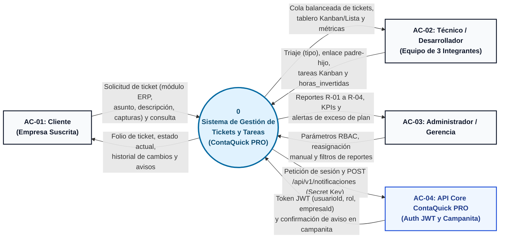
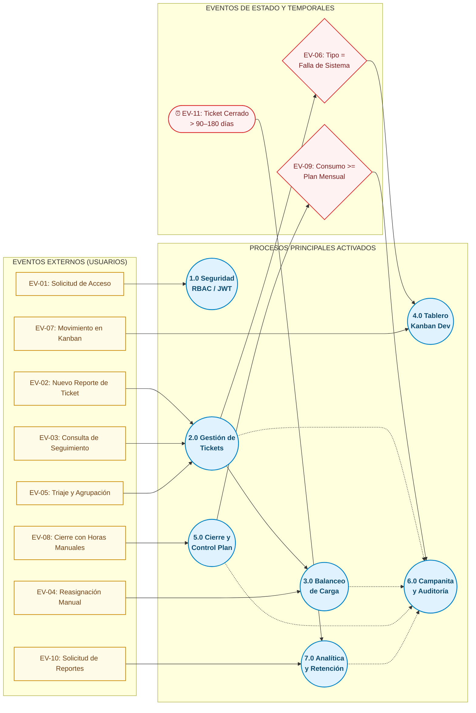

# 1. Modelado de Procesos
El Modelado de Procesos representa la evolución lógica de los casos de uso y macrofunciones definidas hacia Diagramas de Flujo de Datos (DFD) acoplados directamente con la base de datos relacional y con los servicios de integración confirmados por ContaQuick PRO. A diferencia de los diagramas de flujo operativos previos, los DFDs demuestran con precisión de dónde lee la información cada proceso, qué reglas o cálculos aplica, en qué tablas persiste los cambios y qué salidas produce para cada actor.

## 1.1. Catálogo de Almacenes de Datos (D1 a D9)

Para garantizar trazabilidad estricta entre los diagramas de procesos de esta unidad y el Modelo Entidad-Relación (DER) normalizado en 4FN de la Unidad II, todos los almacenes de datos referenciados en los DFDs se estandarizan de la siguiente manera:

| Código DFD | Nombre del Almacén de Datos | Tablas Físicas / Servicio de Almacenamiento Asociado | Esquema / Ubicación |
|---|---|---|---|
| **D1** | Maestro de Empresas y Cuentas | `global_empresas` (horas_mensuales_plan), `global_cuentas_maestras` | `ContaQuickDBMaster` |
| **D2** | Seguridad y Permisos RBAC | `tbl_usuarios`, `tbl_roles`, `tbl_usuarios_roles`, `tbl_objetos`, `tbl_permisos` | `soporte` (PostgreSQL) |
| **D3** | Catálogos de Soporte | `tbl_categorias_ticket` (24 módulos ERP), `tbl_tipos_ticket`, `tbl_estados_ticket` | `soporte` (PostgreSQL) |
| **D4** | Repositorio de Tickets | `tbl_tickets` (folio_ticket, ticket_padre_id, tarea_id, horas_invertidas, fecha_creacion, fecha_cierre) | `soporte` (PostgreSQL) |
| **D5** | Adjuntos y Almacenamiento de Objetos | `tbl_ticket_adjuntos` (metadatos) + Cloudflare R2 (archivos S3 con retención 90–180 días) | `soporte` + Cloudflare R2 |
| **D6** | Historial de Tickets | `tbl_ticket_historial` (transiciones de estado y comentarios) | `soporte` (PostgreSQL) |
| **D7** | Backlog y Tablero de Tareas | `tbl_tareas_desarrollo` (codigo_tarea, estado_kanban, usuario_responsable_id) | `soporte` (PostgreSQL) |
| **D8** | Centro de Notificaciones (Campanita) | `control.notificaciones` (tabla existente consumida vía `POST /api/v1/notificaciones`) | `ContaQuickDBMaster` (control) |
| **D9** | Bitácoras de Auditoría Forense | `tbl_bitacora_auditoria` (JSONB), `control.auditoria_global`, `auditoria.log_auditoria` | `soporte` / `ContaQuickDBMaster` |

## 1.2. Diagrama de Flujo de Datos de Contexto (DFD Nivel 0)
El DFD de Contexto muestra el sistema como un único proceso central (Proceso 0) rodeado de los cuatro agentes externos oficiales (AC-01 a AC-04), evidenciando el intercambio de flujos mediante API REST con tokens JWT y el consumo del endpoint interno de notificaciones.

## 1.3. Diagrama de Descomposición Funcional
El Diagrama de Descomposición Funcional desglosa jerárquicamente el Proceso 0 en los 7 procesos principales derivados de las macrofunciones (MF-01 a MF-07) y en sus 19 procesos elementales ejecutables.

```mermaid
flowchart TB
    ROOT["<b>0. Sistema de Gestión de Tickets y Tareas — ContaQuick PRO</b>"]

    P1["<b>1.0 Seguridad, Identidad<br/>y Acceso RBAC</b><br/><i>(MF-01 | CU-01)</i>"]
    P2["<b>2.0 Recepción y Gestión<br/>de Tickets</b><br/><i>(MF-02 | CU-02, CU-03, CU-05)</i>"]
    P3["<b>3.0 Balanceo de Carga<br/>y Enrutamiento</b><br/><i>(MF-03 | CU-04)</i>"]
    P4["<b>4.0 Gestión de Tareas<br/>de Desarrollo</b><br/><i>(MF-04 | CU-08, CU-09)</i>"]
    P5["<b>5.0 Cierre, Horas y<br/>Control de Planes</b><br/><i>(MF-05 | CU-06, CU-07)</i>"]
    P6["<b>6.0 Notificaciones y<br/>Auditoría Forense</b><br/><i>(MF-06 | Transversal)</i>"]
    P7["<b>7.0 Analítica, Reportes<br/>y Retención</b><br/><i>(MF-07 | CU-10)</i>"]

    ROOT --> P1
    ROOT --> P2
    ROOT --> P3
    ROOT --> P4
    ROOT --> P5
    ROOT --> P6
    ROOT --> P7

    P1 --> P11["1.1 Validar JWT vía API Core"]
    P1 --> P12["1.2 Evaluar Permisos RBAC"]
    P1 --> P13["1.3 Administrar Roles y Objetos"]

    P2 --> P21["2.1 Registrar Ticket y Validar Módulos"]
    P2 --> P22["2.2 Almacenar Adjuntos en R2"]
    P2 --> P23["2.3 Consultar Estado e Historial"]
    P2 --> P24["2.4 Clasificar Tipo y Agrupar Duplicados"]

    P3 --> P31["3.1 Calcular Carga Activa de Técnicos"]
    P3 --> P32["3.2 Asignar Automáticamente / Reasignar"]

    P4 --> P41["4.1 Crear y Vincular Tarea 1:N"]
    P4 --> P42["4.2 Actualizar Avance Kanban / Lista"]

    P5 --> P51["5.1 Registrar Horas Invertidas Manuales"]
    P5 --> P52["5.2 Sellar Cierre y Tiempo Resolución"]
    P5 --> P53["5.3 Auditar Saldo vs. Plan Mensual"]

    P6 --> P61["6.1 Despachar Aviso a Campanita API"]
    P6 --> P62["6.2 Grabar Snapshot JSONB en Bitácora"]

    P7 --> P71["7.1 Generar Reportes R-01 a R-04"]
    P7 --> P72["7.2 Desplegar Dashboard de KPIs"]
    P7 --> P73["7.3 Purgar Adjuntos R2 (90–180 días)"]

    classDef rootNode fill:#0c4a6e,stroke:#082f49,stroke-width:2px,color:#ffffff;
    classDef mainProc fill:#e0f2fe,stroke:#0284c7,stroke-width:2px,color:#0f172a;
    classDef subProc fill:#f8fafc,stroke:#64748b,stroke-width:1px,color:#1e293b;
    class ROOT rootNode;
    class P1,P2,P3,P4,P5,P6,P7 mainProc;
    class P11,P12,P13,P21,P22,P23,P24,P31,P32,P41,P42,P51,P52,P53,P61,P62,P71,P72,P73 subProc;
```

## 1.4. Modelado de Eventos (Tabla de Eventos y Diagrama de Eventos)
Los eventos definen los estímulos externos, temporales o de estado que activan los procesos del sistema. Se incluyen los eventos operativos confirmados y los eventos de retención y sobrecargo definidos por la Dirección Técnica de ContaQuick PRO.
### 1.4.1 Tabla de Especificación de Eventos

# Tabla de Especificación de Eventos

| ID | Evento Disparador | Tipo de Evento | Agente / Origen | Proceso Activado | Respuesta / Salida Esperada |
|---|---|---|---|---|---|
| **EV-01** | Usuario solicita ingreso al módulo de soporte | Externo | AC-01, AC-02, AC-03 | 1.1, 1.2 (CU-01) | Sesión autenticada con JWT (usuarioId, rol, empresaId) y menú RBAC cargado. |
| **EV-02** | Cliente reporta incidencia con módulo ERP y capturas | Externo | AC-01 Cliente | 2.1, 2.2, 3.1, 3.2 (CU-02, CU-04) | Ticket creado en Abierto, adjuntos guardados en Cloudflare R2, técnico asignado y aviso en campanita. |
| **EV-03** | Usuario consulta progreso o historial de solicitudes | Externo | AC-01, AC-02 | 2.3 (CU-03) | Vista filtrada por tenant/rol con estados, adjuntos y línea de tiempo. |
| **EV-04** | Gerencia solicita reasignación manual de un caso | Externo | AC-03 Gerencia | 3.2, 6.1, 6.2 (CU-04) | Cambio de usuario_asignado_id, traza en historial y alerta en campanita. |
| **EV-05** | Técnico inicia atención, clasifica tipo o detecta duplicado | Externo | AC-02 Técnico / Dev | 2.4, 6.1 (CU-05) | Transición a En progreso/En espera, registro de tipo_id y vínculo ticket_padre_id. |
| **EV-06** | Incidencia confirmada como Falla del sistema (Bug) | De Estado | Proceso 2.4 | 4.1 (CU-08) | Creación o enlace 1:N en tbl_tareas_desarrollo con estado Kanban 'Por hacer'. |
| **EV-07** | Desarrollador mueve tarjeta en tablero Kanban/Lista | Externo | AC-02 Técnico / Dev | 4.2, 6.2 (CU-09) | Actualización de estado_kanban; si llega a 'Completada', sella fecha_cierre y notifica. |
| **EV-08** | Técnico ejecuta cierre e ingresa horas_invertidas > 0 | Externo | AC-02 Técnico / Dev | 5.1, 5.2, 5.3, 6.1 (CU-06, CU-07) | Ticket en Cerrado, cálculo de tiempo de resolución (fecha_cierre - fecha_creacion) y aviso a cliente/hijos. |
| **EV-09** | Consumo mensual de empresa alcanza o supera su plan | De Estado | Proceso 5.3 | 6.1, 6.2 (CU-07) | Notificación prioritaria SOPORTE_EXCESO_PLAN en la campanita de AC-03 Gerencia. |
| **EV-10** | Gerencia o técnico consulta dashboard y reportes | Externo | AC-03, AC-02 | 7.1, 7.2 (CU-10) | Generación al vuelo de reportes R-01 a R-04 y KPIs operativos. |
| **EV-11** | Cumplimiento de 90–180 días desde el cierre del ticket | Temporal | Reloj del Sistema (Cron) | 7.3, 6.2 | Purga automática de archivos pesados en Cloudflare R2 conservando bitácora de texto. |

### 1.4.2 Diagrama de Eventos del Sistema
